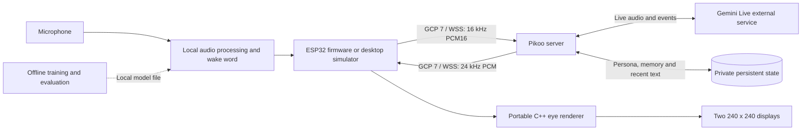

# Pikoo

**English** | [简体中文](README.zh-CN.md)

A DIY voice pet with expressive dual eyes, local Mandarin wake-word detection, realtime conversation, and shared memory. Built for ESP32-S3, with a desktop simulator you can try before connecting hardware.


*Simulator concept preview, not a photograph of a finished device. The two eye displays are rendered at 240 × 240 pixels each.*

## Features

- Original cartoon eyes: closed-eye standby, coordinated gaze, blinking, listening and speaking expressions.
- Local wake-word pipeline targeting “你好 Pikoo” (Mandarin greeting + pī kū, both name syllables first tone); updated pronunciation acceptance is pending. Standby audio stays on the device or local computer.
- Continuous Mandarin conversation, playback cancellation, interruption handling, and reconnection.
- Server-managed persona, shared Markdown memory, and session-summary integration.
- A portable C++ RGB565 eye renderer shared by the simulator and firmware.
- USB provisioning and independently revocable device credentials; no provider key in firmware.

## Project status

**Development preview. Hardware acceptance is pending.**

| Area | Current status |
|---|---|
| Desktop simulator | Dual-eye graphics, offline demo, optional live-server and local-wake integration implemented |
| Server | Deployment templates, Gemini compatibility adapters, device authentication and recent-text context recovery implemented |
| Dual-eye renderer | Native checks and ESP32-S3 cross-compilation passed |
| Firmware | DualEye display, audio, BOOT controls and USB deployment implemented; real voice acceptance in progress |
| Wake word | Training and evaluation tools available; model weights are not included in the current tree |
| Automatic memory | Integration exists; long-session extraction/summary timeout remains an unresolved acceptance item |
| Physical device | USB, displays and short speaker test checked; sustained voice, AEC, wake accuracy and endurance remain under validation |

The local V5 research candidate is 45,128 bytes. Its synthesized-speech results and host checks are **not** evidence of child-voice or hardware acceptance. See [actual validation records](docs/validation-summary.md).

## Architecture



The device listens, wakes, plays audio and displays expressions. The server manages conversations and memory. Provider keys and household information remain in private server storage. Training runs separately from the online voice path. Read [how the modules cooperate](docs/architecture.md) and [context, memory and Beijing time](docs/context-memory.md).

Reconnection restores recent saved text with the same conversation identifier. It does not resume the original audio stream or guarantee unlimited history. Explicitly ending a conversation starts a new topic on the next connection.

## Device

The target is **Waveshare ESP32-S3-DualEye-LCD-1.28**: two 1.28-inch round displays, 16 MB Flash and 8 MB PSRAM. The first prototype uses USB power and a suitable speaker. See the [hardware guide](docs/hardware.md) for official documentation, audio hardware and bring-up requirements.

Use the [DualEye firmware guide](docs/firmware.md). The historical 1.83-EN target is separate and must never be flashed onto DualEye.

## Quick start: offline simulator

Install [Node.js 24 LTS](https://nodejs.org/en/download) or newer and a C++17 compiler. On macOS, install Xcode Command Line Tools; on Linux, install a C++ toolchain such as `build-essential`.

```sh
git clone https://github.com/skiyo/pikoo.git
cd pikoo
(cd server && npm ci --ignore-scripts)
bash tools/start-dualeye.sh
```

Open **http://127.0.0.1:8793/dualeye**. The launcher compiles the eye renderer. Use the expression controls and wake/session button; the offline response is a test tone, not an AI conversation. Opening the page does not enable the microphone or connect to a remote server. The current simulator UI uses Chinese labels.

Stop with Ctrl+C or `bash tools/stop-dualeye.sh`. On macOS, the start/stop `.command` files in `tools/` provide double-click entry points.

The demo needs no model, key, private configuration, Python or ESP-IDF. To add a real server or your own authorized wake model, follow [Getting started](docs/getting-started.md). The original simulator home at `/` and wake test page at `/wake-test` remain available; wake testing requires a configured model.

## Modules and documentation

| Path | Purpose |
|---|---|
| [`server/`](server/README.md) | Relay composition, provider adapters, deployment and private persistence |
| [`firmware/`](docs/development.md) | ESP-IDF firmware baseline, audio/session core and USB configuration |
| [`firmware/components/pikoo_eyes/`](docs/dualeye.md) | Platform-independent eye renderer |
| [`firmware/simulator/`](docs/getting-started.md) | Local browser UI, drawing process, wake worker and WSS client |
| [`training/`](training/README.md) | Training, quantization, dataset import and streaming evaluation |
| [`tools/`](docs/development.md) | Launch, checks, flashing and provisioning tools |

Start with [Architecture](docs/architecture.md), [Hardware](docs/hardware.md), [Getting started](docs/getting-started.md), and [Development](docs/development.md). Historical technical and test records retain their original Chinese text; the [English validation summary](docs/validation-summary.md) explains their dates and limits.

## Open-source software and references

Pikoo builds on qwen-audio-agent, ESP-IDF, ESP-SR, TensorFlow Lite Micro, microWakeWord, microfrontend/KissFFT, LVGL and Waveshare board components. Muse Gadget SDK inspired simulator organization and animation pacing; Pikoo's character and drawing code are original, with no Jollybot assets or copied Muse implementation.

See [Third-party software and attribution](THIRD_PARTY.md) for versions, sources, licenses and the distinction between vendored code, dependencies and design references. Gemini is an external service, not an open-source component; users provide their own credentials and must check applicable availability, pricing and service terms.

## Contributing

Bug reports, documentation improvements, graphics and hardware bring-up contributions are welcome. Read [CONTRIBUTING](CONTRIBUTING.md), run `bash tools/check.sh`, and use the issue/PR templates. Report vulnerabilities privately using [SECURITY](SECURITY.md).

Next milestones: sustained real-device voice; physical AEC and interruption testing; a redistributable wake model; household and endurance validation. See the [dated hardware record](docs/device-validation.md).

## License and privacy

Pikoo-authored code, graphics and documentation are licensed under [Apache-2.0](LICENSE). Third-party components retain their own licenses and notices; see [NOTICE](NOTICE) and [THIRD_PARTY](THIRD_PARTY.md).

**No wake-model weights are distributed in the current tree.** Existing research weights use sources whose redistribution rights have not been established. Historical Git commits retain an early experimental model; it is not granted an Apache-2.0 model license by this repository. See the [model card](training/models/MODEL_CARD.md).

Never commit keys, device tokens, proxy subscriptions, household profiles, raw conversations, recordings or restricted datasets/models. Future model releases require documented training and distribution rights.
