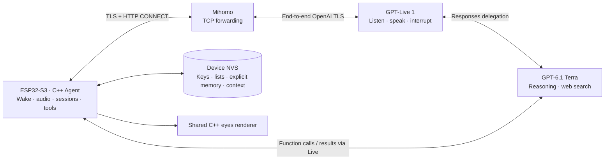

# 🐱Hi Pikoo🐱 2.0.0

**English** | [简体中文](README.zh-CN.md)

**Pikoo is a family AI Agent pet powered by Live models.**

[Website](https://pikoo.lol/en/) · [Firmware and USB](docs/firmware.md) · [Documentation](docs/README.md)


## Quick Start

**Try the eyes on your computer.** Install Node.js 24+, npm, Bash and a C++17 compiler (Xcode Command Line Tools on macOS, `build-essential` on Debian/Ubuntu).

```sh
git clone https://github.com/skiyo/pikoo.git
cd pikoo
(cd server && npm ci --ignore-scripts)
bash tools/start-dualeye.sh
```

Open **http://127.0.0.1:8793/dualeye**. This offline demo needs no API key, wake model or board. Buttons simulate sessions using test tones; they do not start an AI conversation or microphone recording. Stop with Ctrl+C or `bash tools/stop-dualeye.sh`.

**ESP32 voice:** [deploy Mihomo and provision the local Agent](docs/local-agent.zh-CN.md). Write the OpenAI project key and proxy credentials to the device over USB. The remote entry forwards connections.

**Install or upgrade:** follow the [USB guide](docs/firmware.md). New devices can configure Wi-Fi with `tools/configure.py --local-agent`, then write API and proxy credentials with `tools/local-agent-usb.py provision`.

The graphical desktop simulator's optional voice mode still uses the [compatibility Gateway](server/README.md). The [silent simulator](docs/local-agent.zh-CN.md) shares the ESP's C++ Agent core.

## What Pikoo does

- Local **“Hi, Pikoo”** wake word; `piku` and `piko` pronunciations are accepted.
- Continuous Chinese conversation, interruption, local stop, mute and reconnect.
- Two expressive 240 × 240 eyes, sharing an original C++ renderer with the desktop simulator.
- Device-managed sessions, tools, shopping/to-do lists, explicit family memory and bounded text context.
- Search and public-page reading through configured tools.
- Replaceable credentials in device NVS; the remote voice path requires only Mihomo.

Closed eyes mean standby. Waking connects the voice service, opens the eyes when ready and starts a greeting. Saying goodbye ends the active voice connection. Idle sleep releases the paid voice session while keeping local text context available for the next wake. Background automatic memory learning is disabled.

## Architecture



The ESP runs C++ sessions, tools and storage, reaching OpenAI through two TLS layers. Live handles speech; Terra handles delegated reasoning and search. Model inference remains on OpenAI. Mihomo cannot inspect the inner API credentials or content. The GCP 7 Gateway remains available for compatibility and rollback. [Architecture](docs/architecture.md) · [Deployment and tests](docs/local-agent.zh-CN.md)

## Hardware

The target is **Waveshare ESP32-S3-DualEye-LCD-1.28, non-touch**, with 16 MiB Flash, 8 MiB PSRAM and two 240 × 240 round screens. Add a compatible speaker, a USB data cable, stable USB power and 2.4 GHz Wi-Fi. Audio codecs and microphone are on the board.

[Hardware and wiring](docs/hardware.md) · [Three-part printable cat enclosure and STLs](hardware/enclosure/README.md)

## Deploy and develop

| Module | Purpose | Start here |
|---|---|---|
| `firmware/` | Board I/O, wake inference, audio, controls and shared eye renderer | [Firmware](docs/firmware.md) |
| `firmware/simulator/` | Local visual demo and optional real voice | [Quick Start](docs/getting-started.md) |
| `server/` | Mihomo templates and the retained compatibility Gateway | [Server setup](server/README.md) |
| `training/` | Corpus isolation, tempo augmentation, training, quantization and evaluation | [Training](training/README.md) |
| `models/hi-pikoo/` | Current model card, runtime policy, attribution and model terms | [Model card](models/hi-pikoo/MODEL_CARD.md) |
| `tools/` | Build, USB installation, diagnostics and checks | [Development](docs/development.md) |

Run software checks with `bash tools/check.sh`. See [Development](docs/development.md) for changing eyes, boards, tools, Providers and models. The [documentation index](docs/README.md) links current interfaces and operations.

## Requirements and limitations

Online speech requires your own server, model API access and network egress; model and search providers may charge separately. This is a DIY system, not an offline language model. Wake accuracy depends on pronunciation, distance, noise and enclosure acoustics. Real-child recall, 8-hour false-wake and 72-hour endurance targets are not certified by this release. Browser tests do not validate physical AEC.

## Contribute and license

[Contributing](CONTRIBUTING.md) · [Security](SECURITY.md) · [Third-party sources](THIRD_PARTY.md) · [Release verification](docs/release.md)

Original source, eye artwork and documentation: **Apache-2.0**. Wake weights and firmware containing them have [separate non-commercial model terms](models/hi-pikoo/LICENSE.md). Third-party components and training datasets retain their terms; the Apache license does not replace them. No training audio, family recordings, personal profiles or credentials are distributed.
