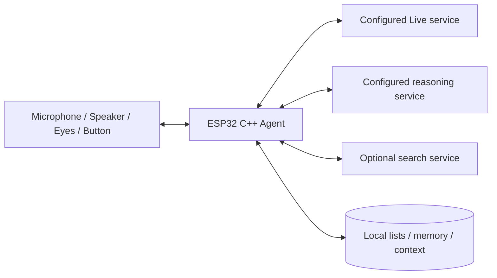

# 🐱 Hi Pikoo · Hardware AI Agent

**English** | [简体中文](README.zh-CN.md)

Pikoo is an ESP32-S3 voice companion with expressive dual eyes and a device-owned C++ Agent. It wakes locally, manages conversations, executes tools and saves lists and explicit memories on the device. Your configured services provide voice and language-model inference.

**English is the default.** Set `agent.language` to `zh-CN` for Chinese dialogue; keep the complete English wake phrase **“Hi, Pikoo”**.

[Quick start](docs/getting-started.md) · [User guide](docs/usage.md) · [FAQ](docs/faq.md) · [All documentation](docs/README.md)

## What you can do

| Capability | Behavior |
|---|---|
| Natural interaction | Local wake, realtime dialogue, follow-ups, interruption and farewell sleep |
| Physical controls | Wake/stop/end/mute through BOOT; USB diagnostics and settings |
| Local organization | Shopping list, todos and explicitly requested memory |
| Information retrieval | Optional web search; webpage extraction with the supporting adapter |
| Expression | Two 240 × 240 eyes driven by shared C++ rendering |
| Maintenance | Replaceable service configuration, data export/import and checked USB installation |

The device owns tool execution and persistence. Conversation requires network services; language models do not run on the ESP. There is no speaker identity system, automatic memory learning, cross-device sync or bundled home automation.

## What you need

- Non-touch **Waveshare ESP32-S3-DualEye-LCD-1.28**, 16 MiB Flash and 8 MiB PSRAM.
- Compatible speaker, data-capable USB cable, stable power and 2.4 GHz Wi-Fi.
- A Live-compatible voice service and a function-calling reasoning service. Search is optional.
- Python for USB installation. ESP-IDF 5.5.5 is required only to build firmware from source.

No Pikoo application server is required. Each service has an independent endpoint, protocol, credential and model. Compatibility depends on implemented protocol capabilities, not merely an “OpenAI-compatible” label. Read the [configuration reference](docs/configuration.md) before selecting services.

## Install and use

1. Download the **firmware ZIP** from [Pikoo 2.0.0](https://github.com/skiyo/pikoo/releases/tag/v2.0.0) and verify its checksums.
2. Create a private configuration from `examples/device.example.json`; fill your Wi-Fi, Live and LLM settings.
3. List USB ports and create a verified full-Flash backup outside the repository.
4. Run the install dry-run, then install firmware and configuration.
5. Check status, unmute and say “Hi, Pikoo”. Try reading and updating a disposable list item.

The [step-by-step quick start](docs/getting-started.md) includes commands, expected outputs, source-build alternatives and the first-use checklist. Use [troubleshooting](docs/troubleshooting.md) for MIC OFF, USB, TLS or service errors.

## Architecture and extension

Live client delegation hands reasoning tasks to the device. The Agent calls the selected LLM, validates and executes registered tools, and returns results to Live. Background HTTPS work is isolated from realtime audio, with bounded queues, task deadlines and cancellation tokens.

[Architecture](docs/architecture.md) · [Tool contract](docs/family-tools.md) · [Development and silent tests](docs/development.md) · [Verification scope](docs/release.md)

| Directory | Contents |
|---|---|
| `firmware/components/pikoo_core` | Shared C++ session, configuration, tools and adapters |
| `firmware/main` | ESP networking, storage, audio and board integration |
| `firmware/simulator` | Native test driver and offline eye preview |
| `tools` | Build, USB setup, validation and packaging |
| `models/hi-pikoo` | TFLite weights, checkpoint, policy and model documentation |
| `training` | Training and evaluation tooling |
| `hardware/enclosure` | Printable STLs and bilingual offline assembly guide |

## Downloads, privacy and licenses

The Release provides a firmware ZIP, model ZIP, application-only BIN, manifest and SHA256SUMS. Weights are also tracked directly in Git; Git LFS is not required. [Model documentation](models/hi-pikoo/README.md) explains which artifact to use.

Idle wake audio stays local; active conversations are processed by configured services. Ordinary NVS stores credentials and is not protected against physical Flash access. Exports omit credentials but still contain private content. See [security and privacy](SECURITY.md).

Original source, documentation and Pikoo-authored artwork use **Apache-2.0**. Wake weights and firmware containing them retain **separate non-commercial model terms** and third-party restrictions. Preserve notices and attribution when redistributing.

[LICENSE](LICENSE) · [NOTICE](NOTICE) · [Model terms](models/hi-pikoo/LICENSE.md) · [Third-party sources](THIRD_PARTY.md) · [Contributing](CONTRIBUTING.md)
