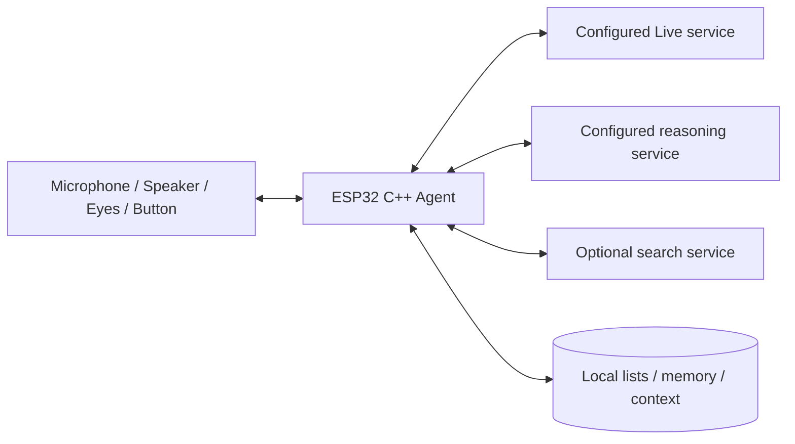

# 🐱 Hi Pikoo · Hardware AI Agent

**English** | [简体中文](README.zh-CN.md)

Pikoo is a hardware AI Agent on ESP32-S3. It wakes locally, manages sessions, executes tools and stores data on the device, using your configured cloud services for voice and reasoning.

[Quick start](docs/getting-started.md) · [Configuration](docs/configuration.md) · [Architecture](docs/architecture.md) · [Documentation](docs/README.md)


## Capabilities

- Local **“Hi, Pikoo”** wake phrase, accepting both `piku` and `piko` pronunciations.
- Realtime voice, interruption, mute, farewell sleep and reconnect.
- Two 240 × 240 expressive eyes rendered by a shared C++ core.
- Device-local shopping lists, todos, explicit memory and bounded conversation context.
- Optional web search and public-page extraction when supported by the configured adapter.
- Separate voice, LLM and search endpoints, keys and models; USB configuration and data backup.

## From configuration to device

The target is the non-touch Waveshare ESP32-S3-DualEye-LCD-1.28 with 16 MiB Flash and 8 MiB PSRAM, microphones, a speaker, USB data cable and 2.4 GHz Wi-Fi. Supply your own API accounts and access; no Pikoo application server is required.

1. Copy `examples/device.example.json` outside the repository and fill in Wi-Fi and service settings.
2. Use the included `models/hi-pikoo/hi_pikoo.tflite`, then follow the firmware guide to build and back up your device.
3. Install firmware and configuration with one USB command. Later configuration changes require no rebuild.

```sh
python tools/configure.py --config /private/pikoo.json --dry-run
python tools/device.py install --port PORT --build firmware/build-dualeye \
  --backup /private/factory-backup --config /private/pikoo.json
```

Endpoints must implement the selected protocol. Connections are direct by default; standard HTTPS CONNECT is optional.

## Agent architecture



The ESP owns state and actions. Live handles voice, an independent LLM chooses reasoning and tools, and search adapters provide external information. Model inference does not run on the ESP.

## Development

| Directory | Responsibility |
|---|---|
| `firmware/components/pikoo_core` | Shared C++ Agent, configuration, service adapters and state |
| `firmware/main` | ESP networking, NVS, audio, wake, displays and controls |
| `firmware/simulator` | Silent native Agent driver and offline eye preview |
| `tools` | Build, USB setup, checks and diagnostics |
| `training` / `models` | Wake training, model policy, provenance and terms |
| `hardware/enclosure` | Enclosure STL and assembly guide |

[Developer guide](docs/development.md) · [Hardware](docs/hardware.md) · [Verification](docs/release.md)

## License

Original source, eye artwork and documentation use Apache-2.0. Wake weights and firmware containing them have separate non-commercial model terms. External API access, charges and terms are separate.

[LICENSE](LICENSE) · [NOTICE](NOTICE) · [Model terms](models/hi-pikoo/LICENSE.md) · [Third-party sources](THIRD_PARTY.md) · [Security](SECURITY.md)

**Model redistribution permission is pending.** ChildMandarin-trained weights and firmware embedding them are not cleared by the source license. See the [public audit](docs/public-audit.md) and [model distribution status](models/hi-pikoo/distribution-status.json).
