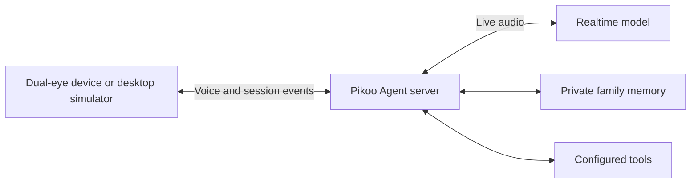

# Pikoo

**English** | [简体中文](README.zh-CN.md)

**A realtime voice AI Agent for your family.**

Pikoo is not a typical smart speaker. It is an open-source DIY project you can build yourself: a small companion for children’s discoveries and everyday family life.

[Explore Pikoo](https://pikoo.lol/) · [Get started](docs/getting-started.md) · [Development guide](docs/development.md)

<p align="center">
  
  <br>
  <em>Pikoo cat-enclosure appearance concept render.</em>
</p>

## What it is like to spend time with Pikoo

- **Let the conversation flow.** Realtime voice follows the context, with local controls for stopping playback and handling interruptions.
- **Pick up where you left off.** Conversation context, shared family memory and past-topic recall help carry meaningful details into the next conversation.
- **Work things out together.** The Agent can use the tools you configure. The server includes adapters for search, public-page reading and family lists; see [tool setup](docs/family-tools.md).

Its two animated eyes give responses a visible expression. The optional [quiet companion mode](docs/companion.md) lets an explicitly awakened device stay connected and decide when to respond.

## How it works

| Part | Role |
|---|---|
| [Waveshare ESP32-S3 DualEye board](https://www.waveshare.net/shop/ESP32-S3-DualEye-LCD-1.28.htm) | Capture audio, play responses and display two expressive eyes |
| [Qwen Audio Agent](https://github.com/QwenAudio/qwen-audio-agent) + Pikoo server adapters | Coordinate sessions, device authentication, memory and tools |
| Realtime voice model | Understand speech and generate live responses; the current adapters target Gemini Live |



Qwen Audio Agent is the runtime framework, separate from the model it connects to. The runtime can be extended through tool interfaces such as MCP; weather and smart-home services are possible integrations, not services enabled by default in this repository. Current server configuration and compatibility limits are documented in [Architecture](docs/architecture.md) and [server setup](server/README.md).

## Start on your computer

The offline simulator is the shortest path to the eyes and interaction controls. It needs Node.js 24+, npm, Bash and a C++17 compiler. On macOS, install Xcode Command Line Tools; on Linux, use an equivalent compiler toolchain.

```sh
git clone https://github.com/skiyo/pikoo.git
cd pikoo
(cd server && npm ci --ignore-scripts)
bash tools/start-dualeye.sh
```

Open **http://127.0.0.1:8793/dualeye**. Offline responses are test tones, not AI conversation. The demo needs no model weights, provider key, Python or ESP-IDF; opening it does not start the microphone. Stop with Ctrl+C or `bash tools/stop-dualeye.sh`.

For live voice, connect your own Agent server and a separately issued device token. For the physical build, use the non-touch **ESP32-S3-DualEye-LCD-1.28**, USB power and a suitable speaker. Follow [Getting started](docs/getting-started.md), then the [hardware](docs/hardware.md) and [DualEye firmware](docs/firmware.md) guides. The older 1.83-inch target is a separate project.

## Choose what to develop

| Source | Starting point |
|---|---|
| [`firmware/main/`](firmware/main/) | Board peripherals, capture, playback and dual-display integration |
| [`firmware/components/pikoo_core/`](firmware/components/pikoo_core/) | Audio/session state, cancellation and resampling |
| [`firmware/components/pikoo_eyes/`](firmware/components/pikoo_eyes/) | Portable C++ eye rendering, gaze, blinking and expressions |
| [`firmware/simulator/`](firmware/simulator/) | Desktop interaction, local graphics, optional wake worker and server connection |
| [`server/`](server/README.md) | Agent composition, provider adapters, memory and tool configuration |
| [`training/`](training/README.md) | Authorized wake-word data, training, export and evaluation |
| [`tools/`](tools/) | Launch, build, USB provisioning and diagnosis |
| [`docs/`](docs/README.md) | Setup, architecture, development and dated validation records |

The [development guide](docs/development.md) explains environments and checks. Low-level protocol and deployment details live in their own guides rather than in this introduction.

## Before you build

- **Development preview:** software checks and short device runs do not establish sustained voice, hardware AEC, child wake-word accuracy or long-term reliability. See the [validation summary](docs/validation-summary.md).
- **Wake models:** the target phrase is “你好 Pikoo” (pī kū). No model weights are distributed in the current tree. Use an authorized private model or the [training workflow](training/README.md); historical weights are not granted an Apache-2.0 model license.
- **Language and services:** documentation is bilingual; the current conversation policy uses Mandarin Chinese replies. Live models and online tools require network access and separately configured services. Costs depend on those services.
- **Family data:** provider keys, persona, memory and conversation state are managed on the private server. The device holds its own revocable credential and does not infer which family member is speaking. Read [memory and data flow](docs/context-memory.md) and [Security](SECURITY.md).

## Contribute and reuse

Documentation, original expressions, device integration and reproducible bug reports are welcome. Read [Contributing](CONTRIBUTING.md); documentation-only changes need link and example checks, while behavior changes need the relevant software tests.

Pikoo-authored code, graphics and documentation use [Apache-2.0](LICENSE). Dependencies and vendored components retain their own licenses; see [NOTICE](NOTICE) and [Third-party attribution](THIRD_PARTY.md). Credentials, household recordings, restricted datasets and unlicensed model weights must stay outside public commits.
