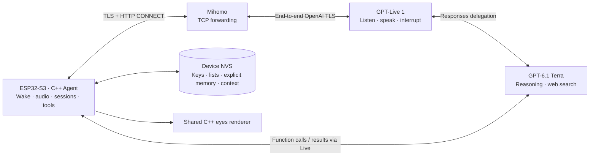

# 🐱Hi Pikoo🐱 2.0.0

[English](README.md) | **简体中文**

**Pikoo 是一个基于 Live 模型的家庭 AI Agent 宠物。**

[官网](https://pikoo.lol/) · [固件与 USB](docs/firmware.zh-CN.md) · [项目文档](docs/README.zh-CN.md)


## Quick Start

**先在电脑上体验双眼。** 需要 Node.js 24+、npm、Bash 和 C++17 编译器。macOS 安装 Xcode Command Line Tools；Debian/Ubuntu 安装 `build-essential`。

```sh
git clone https://github.com/skiyo/pikoo.git
cd pikoo
(cd server && npm ci --ignore-scripts)
bash tools/start-dualeye.sh
```

打开 **http://127.0.0.1:8793/dualeye**。离线演示不需要 API Key、唤醒模型或板子；按钮用测试音模拟交互，不会自动开始 AI 对话或录音。按 Ctrl+C 或运行 `bash tools/stop-dualeye.sh` 停止。

**ESP32 接入真实语音：** [部署 Mihomo 并配置本地 Agent](docs/local-agent.zh-CN.md)。OpenAI 项目密钥和代理凭证通过 USB 写入设备，远程入口只转发连接。

**安装或升级实机：** 按 [USB 安装说明](docs/firmware.zh-CN.md)备份、构建与刷写。新设备可用 `tools/configure.py --local-agent` 配置 Wi-Fi，随后用 `tools/local-agent-usb.py provision` 写入 API 与代理凭证。

桌面图形模拟器的可选联网语音仍使用[兼容 Gateway](server/README.zh-CN.md)；[静默模拟器](docs/local-agent.zh-CN.md#无声回归)与 ESP 共用本地 Agent C++ 核心。

## 当前功能

- 本地 **“Hi, Pikoo”** 唤醒，接受 `piku`、`piko` 两种读音。
- 连续中文对话、插话、停止回答、静音与重连。
- 两块 240 × 240 表情眼屏，与桌面模拟器共用原创 C++ 绘制核心。
- ESP 本地管理会话、工具、购物清单、待办、显式家庭记忆与有限文字上下文。
- 通过配置的工具搜索互联网、阅读公开网页。
- 密钥保存在设备普通 NVS，可通过 USB 更新或删除；服务器只需运行 Mihomo。

闭眼表示待机。唤醒后连接语音服务，就绪后睁眼并主动问候；告别结束当前语音连接。空闲休眠释放计费语音连接，本地文字上下文可供下次唤醒恢复。后台自动记忆学习默认不启用。

## 整体架构



ESP 用 C++ 运行 Agent 会话、工具和持久化，通过两层 TLS 与 OpenAI 通信。Live 负责听说，Terra 负责委派推理与搜索；模型推理仍在 OpenAI。Mihomo 看不到内层 API 密钥和内容。原有 GCP 7 Gateway 模式保留作兼容与回滚。[架构设计](docs/architecture.zh-CN.md) · [本地部署与测试](docs/local-agent.zh-CN.md)

## 设备

目标板为 **微雪 ESP32-S3-DualEye-LCD-1.28 非触摸版**：16MiB Flash、8MiB PSRAM，两块 240 × 240 圆屏。另需匹配的喇叭、USB 数据线、稳定 USB 供电和 2.4GHz Wi-Fi。板载音频编解码器与麦克风。

[硬件与接线](docs/hardware.zh-CN.md) · [三件式小猫外壳与 STL](hardware/enclosure/README.zh-CN.md)

## 部署与二次开发

| 模块 | 职责 | 入口 |
|---|---|---|
| `firmware/` | 板级接口、唤醒推理、音频、按键与双眼 | [固件](docs/firmware.zh-CN.md) |
| `firmware/simulator/` | 本机图形演示与可选真实语音 | [快速开始](docs/getting-started.zh-CN.md) |
| `server/` | Mihomo 部署模板与保留的兼容 Gateway | [服务端](server/README.zh-CN.md) |
| `training/` | 数据隔离、变速增强、训练、量化与评估 | [训练](training/README.zh-CN.md) |
| `models/hi-pikoo/` | 当前模型卡、策略、来源与使用条款 | [模型卡](models/hi-pikoo/MODEL_CARD.zh-CN.md) |
| `tools/` | 构建、USB 安装、诊断和检查 | [开发说明](docs/development.zh-CN.md) |

使用 `bash tools/check.sh` 运行软件检查。[开发说明](docs/development.zh-CN.md)介绍如何替换表情、适配板卡、增加工具、更换 Provider 和导出模型；[文档目录](docs/README.zh-CN.md)提供全部当前入口。

## 使用要求与限制

联网对话需要自己的服务器、模型 API 权限和可用网络；模型和搜索服务可能单独收费。唤醒效果受读音、距离、噪声和外壳声学影响。本次版本不声称完成真实儿童召回、8 小时误唤醒和 72 小时稳定性认证。浏览器测试不能证明实机 AEC 效果。

## 贡献与许可证

[贡献](CONTRIBUTING.zh-CN.md) · [安全](SECURITY.zh-CN.md) · [第三方来源](THIRD_PARTY.zh-CN.md) · [发布检查](docs/release.zh-CN.md)

原创代码、眼睛图形及文档采用 **Apache-2.0**。唤醒权重和包含权重的固件附有[独立非商业模型条款](models/hi-pikoo/LICENSE.md)。第三方组件和训练数据保留各自条款，Apache 许可不替代这些条款。不分发训练音频、家庭录音、私人资料或凭证。

**模型公开分发权限待确认。** ChildMandarin 训练权重及内嵌权重的固件，不能由源码许可证获得授权。见[公开审核](docs/public-audit.zh-CN.md)与[模型分发状态](models/hi-pikoo/distribution-status.json)。
