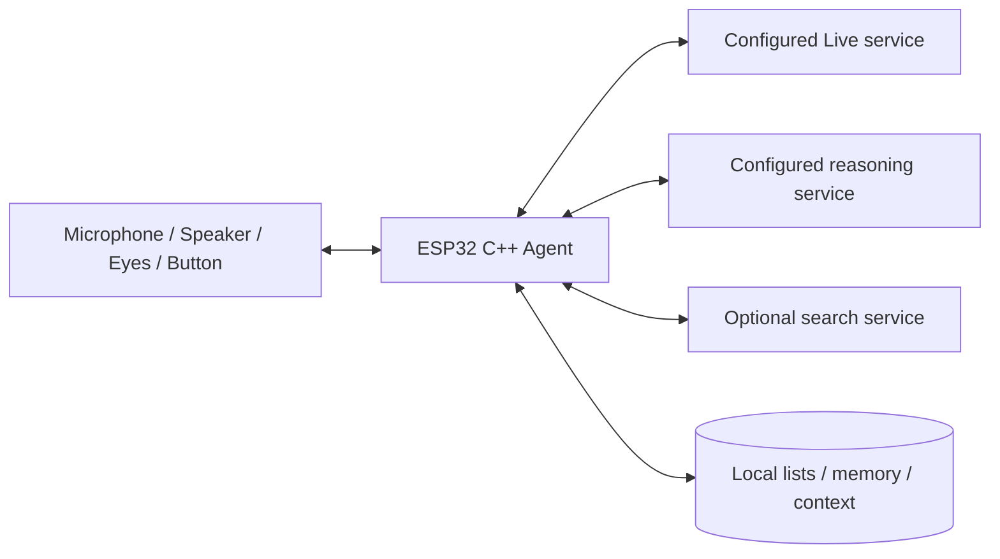

# 🐱 Hi Pikoo · Hardware AI Agent

[English](README.md) | **简体中文**

Pikoo 是一个运行在 ESP32-S3 上的硬件 AI Agent：在本地唤醒、管理会话、执行工具和保存数据，通过自己配置的云端服务获得语音与推理能力。

[快速开始](docs/getting-started.zh-CN.md) · [服务配置](docs/configuration.zh-CN.md) · [架构](docs/architecture.zh-CN.md) · [全部文档](docs/README.zh-CN.md)


默认使用英文；配置 `agent.language = "zh-CN"` 可切换中文。文档与离线指南均提供中英文。

## 能做什么

- 本地完整英文 **“Hi, Pikoo”** 唤醒，支持 `piku`、`piko` 两种读音。
- 实时语音对话、插话停止、静音、告别休眠和断线恢复。
- 两块 240 × 240 表情眼屏，共用原创 C++ 绘制核心。
- 本地购物清单、待办、显式记忆和有界短期上下文。
- 可选联网搜索；启用网页提取适配器后可读取公开网页。
- 独立配置语音、LLM、搜索的地址、密钥和模型；USB 更新配置与备份数据。

## 从配置到设备

目标硬件为微雪 ESP32-S3-DualEye-LCD-1.28 非触摸版，16 MiB Flash、8 MiB PSRAM，配套麦克风、喇叭、USB 数据线与 2.4 GHz Wi-Fi。联网对话需要自己的服务账号和 API 权限，不需要部署 Pikoo 服务端。

1. 复制 `examples/device.example.json` 到仓库外，填写 Wi-Fi 和服务参数。
2. 使用仓库内 `models/hi-pikoo/hi_pikoo.tflite`，按固件指南构建并备份设备。
3. 使用 USB 安装器一次完成刷写和配置；之后可只更新配置。

```sh
python tools/configure.py --config /private/pikoo.json --dry-run
python tools/device.py install --port PORT --build firmware/build-dualeye \
  --backup /private/factory-backup --config /private/pikoo.json
```

服务必须兼容所选择的协议。默认直连，网络需要时可选用标准 HTTPS CONNECT。

## Agent 架构



ESP 负责状态和动作，Live 负责听说，独立 LLM 负责推理与工具选择，搜索适配器提供外部资料。模型推理不在 ESP 上运行。

## 开发与扩展

| 目录 | 职责 |
|---|---|
| `firmware/components/pikoo_core` | Shared C++ Agent, configuration, service adapters and state |
| `firmware/main` | ESP networking, NVS, audio, wake, displays and controls |
| `firmware/simulator` | Silent native Agent driver and offline eye preview |
| `tools` | Build, USB setup, checks and diagnostics |
| `training` / `models` | Wake training, model policy, provenance and terms |
| `hardware/enclosure` | Enclosure STL and assembly guide |

[开发指南](docs/development.zh-CN.md) · [硬件](docs/hardware.zh-CN.md) · [验证范围](docs/release.zh-CN.md)

## 许可证

原创源码、眼睛图形和文档采用 Apache-2.0；唤醒权重及包含权重的固件另有非商业模型条款。外部 API 的权限、费用和服务条款独立。

[LICENSE](LICENSE) · [NOTICE](NOTICE) · [模型条款](models/hi-pikoo/LICENSE.md) · [第三方来源](THIRD_PARTY.zh-CN.md) · [Security](SECURITY.zh-CN.md)

**模型公开分发权限待确认。** ChildMandarin 训练权重及内嵌权重的固件，不能由源码许可证获得授权。见[公开审核](docs/public-audit.zh-CN.md)与[模型分发状态](models/hi-pikoo/distribution-status.json)。
