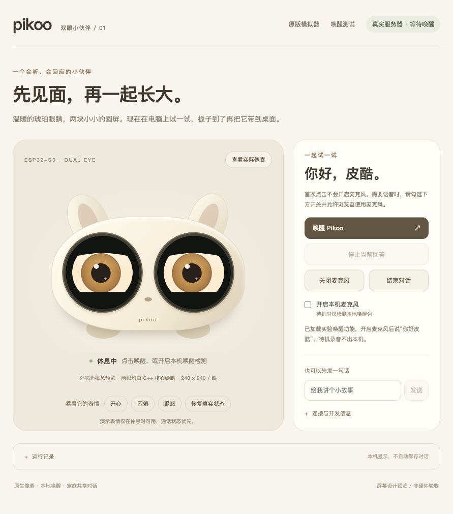
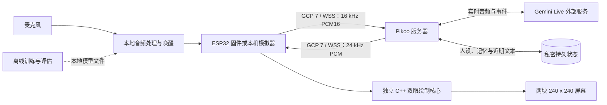

# Pikoo

[English](README.md) | **简体中文**

一个可以自己动手开发的双眼语音宠物：本地普通话唤醒、实时对话、共享记忆和有表情的眼睛。面向 ESP32-S3，板子到货前也可以用本机模拟器体验。



*这是模拟器概念效果，不是已完成设备的实物照片。每块眼屏按 240 × 240 像素绘制。*

## 功能

- 原创卡通眼睛：闭眼待机、协调视线、眨眼，以及倾听和说话表情。
- 本地唤醒流水线；当前目标为“你好 Pikoo”（名字 pī kū，两个第一声），新发音目标待验收。待机音频只留在设备或本机。
- 连续中文对话、停止回答、插话处理和断线重连。
- 服务器管理人设、共享 Markdown 记忆及会话摘要集成。
- 模拟器和固件复用同一套独立 C++ RGB565 双眼绘制核心。
- USB 配置与可单独撤销的设备凭证；固件不保存模型服务 Key。

## 当前进度

**开发预览阶段，实机验收尚未完成。**

| 部分 | 当前状态 |
|---|---|
| 本机模拟器 | 双眼图形、离线演示、可选真实服务器与本地唤醒接入已实现 |
| 服务器 | 部署模板、Gemini 兼容适配、设备鉴权和近期文本上下文恢复已实现 |
| 双眼绘制核心 | 主机检查和 ESP32-S3 交叉编译通过 |
| 固件 | 双眼显示、音频、BOOT 控制和 USB 工具已实现；真实语音正在验收 |
| 唤醒 | 提供训练与评估工具；当前公开文件树不含模型权重 |
| 自动记忆 | 已集成；长会话记忆提取/摘要超时仍是未通过项 |
| 实机 | USB、双屏和短音已检查；持续通话、AEC、唤醒与长期运行仍在验证 |

本机 V5 研究候选模型为 45,128 字节。合成语音结果和主机检查不能证明真实儿童或硬件效果达标。参见[实际验收记录摘要](docs/validation-summary.zh-CN.md)。

## 整体架构



设备负责听、唤醒、播放和表情；服务器负责对话与记忆。模型服务 Key 和家庭资料留在服务器私密目录。训练独立于在线通话链路。详见[模块协作说明](docs/architecture.zh-CN.md)。

断线后使用相同会话编号，可恢复已保存的近期文本；不恢复原始音频流，也不保证无限历史。主动结束对话后，下次连接开始新话题。

## 设备

目标板为 **微雪 ESP32-S3-DualEye-LCD-1.28**：两块 1.28 英寸圆屏、16 MB Flash、8 MB PSRAM。首版使用 USB 供电和匹配的扬声器。[设备说明](docs/hardware.zh-CN.md)包含官方资料、音频硬件和到板验证要求。

使用[双眼固件说明](docs/firmware.zh-CN.md)。历史 1.83-EN 工程独立保留，不能烧录到双眼板。

## 快速开始：离线模拟器

安装 [Node.js 24 LTS](https://nodejs.org/en/download) 或更新版本，以及支持 C++17 的编译器。macOS 使用 Xcode Command Line Tools；Linux 可安装 `build-essential` 等工具链。

```sh
git clone https://github.com/skiyo/pikoo.git
cd pikoo
(cd server && npm ci --ignore-scripts)
bash tools/start-dualeye.sh
```

打开 **http://127.0.0.1:8793/dualeye**。启动工具自动编译眼睛绘制程序。可以演示表情、点击唤醒/会话按钮；离线回复是测试音，不是 AI 对话。打开网页不会自动开启麦克风或连接远程服务。当前模拟器界面使用中文。

按 Ctrl+C 或执行 `bash tools/stop-dualeye.sh` 停止。macOS 也可以双击 `tools/` 中的启动和停止 `.command` 文件。

离线演示不需要模型、Key、私密配置、Python 或 ESP-IDF。接入真实服务器或自己的授权模型见[开始使用](docs/getting-started.zh-CN.md)。原首页 `/` 和独立唤醒测试 `/wake-test` 保留；唤醒测试需要配置模型。

## 模块与文档

| 路径 | 用途 |
|---|---|
| [`server/`](server/README.md) | 中转服务组装、Provider 适配、部署与私密持久化 |
| [`firmware/`](docs/development.zh-CN.md) | ESP-IDF 固件基线、音频/会话核心和 USB 配置 |
| [`firmware/components/pikoo_eyes/`](docs/dualeye.md) | 不依赖平台的双眼绘制核心 |
| [`firmware/simulator/`](docs/getting-started.zh-CN.md) | 网页、本机绘制进程、唤醒进程和 WSS 客户端 |
| [`training/`](training/README.md) | 训练、量化、数据导入与流式评估 |
| [`tools/`](docs/development.zh-CN.md) | 启停、检查、烧录与配置工具 |

建议按[架构](docs/architecture.zh-CN.md)、[设备](docs/hardware.zh-CN.md)、[开始使用](docs/getting-started.zh-CN.md)、[开发](docs/development.zh-CN.md)阅读。历史技术与测试记录保留中文原文，并提供[英文验收摘要](docs/validation-summary.md)，明确日期与验证边界。

## 开源软件与参考来源

项目使用 qwen-audio-agent、ESP-IDF、ESP-SR、TensorFlow Lite Micro、microWakeWord、microfrontend/KissFFT、LVGL 和微雪板级组件。Muse Gadget SDK 提供了模拟器组织和动画节奏的参考；Pikoo 角色和绘制代码为原创，未使用 Jollybot 素材，也未复制 Muse 实现。

[第三方软件与来源](THIRD_PARTY.zh-CN.md)分别列出固定版本、来源、许可、直接引用代码、安装依赖和设计参考。Gemini 是外部服务，不属于开源组件；使用者提供自己的凭证，并自行核实服务地区、价格和条款。

## 参与贡献

欢迎缺陷报告、文档改进、图形设计和硬件适配。先阅读[贡献指南](CONTRIBUTING.zh-CN.md)，执行 `bash tools/check.sh`，并使用 Issue/PR 模板。漏洞请按照[安全说明](SECURITY.zh-CN.md)私密报告。

接下来完成：实机持续通话、AEC 与插话、可分发唤醒模型、家庭体验及长期运行验收。见[带日期的实机记录](docs/device-validation.md)。

## 许可证与隐私

Pikoo 原创代码、图形和文档采用 [Apache-2.0](LICENSE)。第三方组件保留自身许可和声明，见 [NOTICE](NOTICE) 和[来源说明](THIRD_PARTY.zh-CN.md)。

**当前公开文件树不分发唤醒模型权重。** 现有研究权重的数据来源分发权利尚未确认。旧 Git 提交仍保留早期实验模型，不表示仓库已授予该模型 Apache-2.0 许可。详见[模型卡](training/models/MODEL_CARD.md)。

密钥、设备凭证、代理订阅、家庭资料、原始对话、录音、受限语料和模型不要提交。后续模型发布需要完整记录训练及分发授权。
