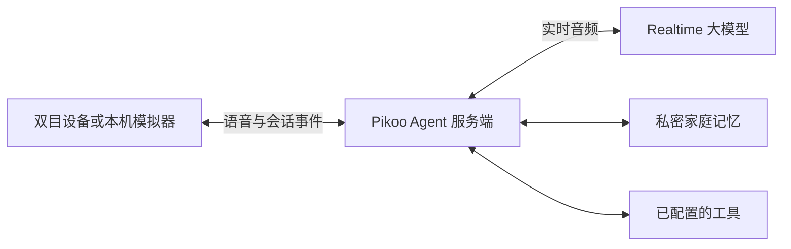

# Pikoo

[English](README.md) | **简体中文**

**面向家庭的实时语音 AI Agent。**

Pikoo 绝不是市面上常见的智能音箱。它是一个可以亲手打造的开源 DIY 项目，陪孩子探索新发现，也参与一家人的日常。

[认识 Pikoo](https://pikoo.lol/) · [开始使用](docs/getting-started.zh-CN.md) · [开发指南](docs/development.zh-CN.md)

<p align="center">
  
  <br>
  <em>Pikoo 小猫外壳外观概念渲染。</em>
</p>

## 相处是什么体验

- **自然地聊。** 实时语音结合上下文展开，设备提供停止播放和插话处理能力。
- **接着上次聊。** 对话上下文、家庭共享记忆和历史话题回顾，让共同的小事延续到下一次交流。
- **一起找办法。** Agent 可以调用你配置的工具；服务端已提供搜索、公开网页阅读和家庭清单适配，使用方式见[工具配置](docs/family-tools.zh-CN.md)。

两块会动的眼睛让回应有了表情。可选的[安静陪伴模式](docs/companion.zh-CN.md)支持明确唤醒后持续连接，由模型判断何时回应。

## 它如何工作

| 部分 | 职责 |
|---|---|
| [微雪 ESP32-S3 双目开发板](https://www.waveshare.net/shop/ESP32-S3-DualEye-LCD-1.28.htm) | 采集声音、播放回答，在两块圆屏上显示表情 |
| [Qwen Audio Agent](https://github.com/QwenAudio/qwen-audio-agent) 与 Pikoo 服务端适配 | 组织会话、设备鉴权、记忆与工具协作 |
| 实时语音大模型 | 理解语音并实时生成回答；当前适配面向 Gemini Live |



Qwen Audio Agent 是运行框架，与所连接的大模型分工不同。运行时可通过 MCP 等工具接口扩展；天气和智能家居属于可接入的方向，不是本仓库默认启用的服务。当前配置及兼容边界见[架构说明](docs/architecture.zh-CN.md)和[服务端指南](server/README.zh-CN.md)。

## 先在电脑上开始

离线模拟器是体验双眼和交互控制的最短路径。需要 Node.js 24+、npm、Bash 和 C++17 编译器。macOS 安装 Xcode Command Line Tools；Linux 使用相应编译工具链。

```sh
git clone https://github.com/skiyo/pikoo.git
cd pikoo
(cd server && npm ci --ignore-scripts)
bash tools/start-dualeye.sh
```

打开 **http://127.0.0.1:8793/dualeye**。离线回答是测试音，不是 AI 对话。演示不需要模型权重、Provider Key、Python 或 ESP-IDF；打开页面不会自动采集麦克风。按 Ctrl+C 或执行 `bash tools/stop-dualeye.sh` 停止。

体验实时语音时，再连接自己的 Agent 服务端和单独签发的设备凭证。制作实物使用非触摸版 **ESP32-S3-DualEye-LCD-1.28**、USB 供电及合适的喇叭。先读[开始使用](docs/getting-started.zh-CN.md)，再按[硬件说明](docs/hardware.zh-CN.md)和[双眼固件指南](docs/firmware.zh-CN.md)操作。旧款 1.83 英寸板属于独立工程。

## 按想改的部分找到源码

| 源码 | 开发入口 |
|---|---|
| [`firmware/main/`](firmware/main/) | 板卡外设、采音、播放与双屏集成 |
| [`firmware/components/pikoo_core/`](firmware/components/pikoo_core/) | 音频和会话状态、取消与重采样 |
| [`firmware/components/pikoo_eyes/`](firmware/components/pikoo_eyes/) | 独立 C++ 眼睛绘制、视线、眨眼与表情 |
| [`firmware/simulator/`](firmware/simulator/) | 电脑交互、本地图形、可选唤醒进程及服务端连接 |
| [`server/`](server/README.zh-CN.md) | Agent 组装、Provider 适配、记忆及工具配置 |
| [`training/`](training/README.zh-CN.md) | 授权唤醒语料、训练、导出和评估 |
| [`tools/`](tools/) | 启停、构建、USB 配置与诊断 |
| [`docs/`](docs/README.zh-CN.md) | 上手、架构、开发和带日期的验证记录 |

环境和检查方式见[开发指南](docs/development.zh-CN.md)。协议细节、部署操作和实验结果分别由专项文档承接。

## 动手之前

- **开发预览：** 软件检查和短时设备运行，不能证明持续通话、硬件 AEC、儿童唤醒和长期稳定性已经通过，参见[验证摘要](docs/validation-summary.zh-CN.md)。
- **唤醒模型：** 目标词是“你好 Pikoo”（pī kū）。当前公开文件树不分发模型权重；使用授权私密模型，或按[训练流程](training/README.zh-CN.md)准备。历史权重未因代码开源而获得 Apache-2.0 模型许可。
- **语言和服务：** 文档支持中英文；当前对话策略使用普通话回答。实时模型和在线工具需要联网并单独配置，费用取决于所选服务。
- **家庭数据：** Provider Key、人设、记忆和会话状态由私密服务端管理。设备只持有自己的可撤销凭证，不根据声音识别家庭成员。数据流见[记忆说明](docs/context-memory.zh-CN.md)和[安全说明](SECURITY.zh-CN.md)。

## 参与开发与复用

欢迎文档、原创表情、设备集成和可复现的缺陷报告。先读[贡献指南](CONTRIBUTING.zh-CN.md)；纯文档修改检查链接和示例，行为变化执行对应软件测试。

Pikoo 原创代码、图形和文档采用 [Apache-2.0](LICENSE)。依赖和引用组件保留各自许可，见 [NOTICE](NOTICE) 和[第三方来源](THIRD_PARTY.zh-CN.md)。凭证、家庭录音、受限语料和没有公开授权的权重不进入公共提交。
