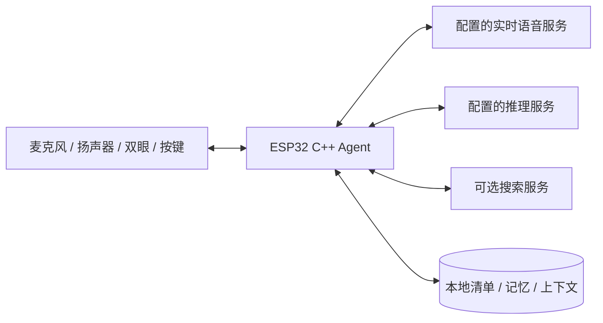

# 🐱 Hi Pikoo · 硬件 AI Agent

[English](README.md) | **简体中文**

Pikoo 是基于 ESP32-S3 的语音伙伴，拥有双眼表情和在设备上运行的 C++ Agent。设备负责本地唤醒、会话管理、工具执行，以及清单和显式记忆保存；配置的外部服务提供语音与语言模型推理。

**默认语言为英文。** 将 `agent.language` 设为 `zh-CN` 可使用中文对话，完整英文唤醒词仍为 **“Hi, Pikoo”**。

[快速开始](docs/getting-started.zh-CN.md) · [使用指南](docs/usage.zh-CN.md) · [常见问题](docs/faq.zh-CN.md) · [全部文档](docs/README.zh-CN.md)

## 可以做什么

| 能力 | 行为 |
|---|---|
| 自然交互 | 本地唤醒、实时对话、追问、插话、告别休眠 |
| 物理控制 | BOOT 唤醒/停止/结束/静音，USB 诊断和设置 |
| 本地整理 | 购物清单、待办、明确要求保存的记忆 |
| 信息检索 | 可选联网搜索，适配器支持时提供网页提取 |
| 表情 | 共享 C++ 渲染驱动两块 240 × 240 双眼屏幕 |
| 维护 | 可更新服务配置、数据导入导出、经过检查的 USB 安装 |

工具执行和持久化由设备负责，对话需要网络服务，ESP 内不运行大语言模型。不提供声纹身份、自动记忆学习、跨设备同步或内置智能家居集成。

## 需要准备什么

- 非触摸版 **Waveshare ESP32-S3-DualEye-LCD-1.28**，16 MiB Flash、8 MiB PSRAM。
- 兼容扬声器、USB 数据线、稳定电源、2.4 GHz Wi-Fi。
- 兼容 Live 的实时语音服务，以及支持函数调用的推理服务；搜索可选。
- USB 安装需要 Python；只有源码构建才需要 ESP-IDF 5.5.5。

不需要部署 Pikoo 应用服务器。每种服务独立设置地址、协议、凭证和模型。是否兼容取决于实际协议能力，而非“兼容 OpenAI”标签。选择服务前请阅读[配置参考](docs/configuration.zh-CN.md)。

## 安装与使用

1. 从 [Pikoo 2.0.0](https://github.com/skiyo/pikoo/releases/tag/v2.0.0) 下载 **firmware ZIP** 并校验文件。
2. 根据 `examples/device.example.json` 创建私有配置，填写 Wi-Fi、Live 和 LLM。
3. 查询 USB 串口，在仓库外创建完整且经过验证的 Flash 备份。
4. 运行安装预检查，再写入固件和配置。
5. 查询状态、取消静音，说出“Hi, Pikoo”，尝试读取和修改一条临时清单项。

[逐步快速开始](docs/getting-started.zh-CN.md)提供命令、预期输出、源码构建替代路径和首次验收步骤。MIC OFF、USB、TLS 或服务问题见[故障排查](docs/troubleshooting.zh-CN.md)。

## 架构与扩展

Live 客户端委派把推理任务交给设备，Agent 调用选定 LLM，校验并执行注册工具，然后将结果回传 Live。后台 HTTPS 与实时音频隔离，并限制队列、期限和取消标识。

[架构](docs/architecture.zh-CN.md) · [工具契约](docs/family-tools.zh-CN.md) · [开发与静默测试](docs/development.zh-CN.md) · [验证范围](docs/release.zh-CN.md)

| 目录 | 内容 |
|---|---|
| `firmware/components/pikoo_core` | 共享 C++ 会话、配置、工具和适配器 |
| `firmware/main` | ESP 网络、存储、音频和板级集成 |
| `firmware/simulator` | 原生测试驱动和离线双眼预览 |
| `tools` | 构建、USB 设置、验证和打包 |
| `models/hi-pikoo` | TFLite 权重、checkpoint、策略和模型文档 |
| `training` | 训练与评估工具 |
| `hardware/enclosure` | 可打印 STL 和双语离线装配指南 |

## 下载、隐私与许可

Release 提供固件 ZIP、模型 ZIP、仅应用 BIN、清单和 SHA256SUMS。权重也直接保存在 Git 中，不需要 Git LFS。[模型说明](models/hi-pikoo/README.zh-CN.md)解释各文件用途。

待机唤醒音频保留在本地，活动会话由配置的服务商处理。凭证保存在普通 NVS，不防护物理 Flash 读取。数据导出排除凭证，但仍含私有内容。详见[安全与隐私](SECURITY.zh-CN.md)。

原创源码、文档和 Pikoo 原创图形采用 **Apache-2.0**；唤醒权重及包含权重的固件另受**非商业模型条款**和第三方限制约束。再分发时保留声明和署名。

[LICENSE](LICENSE) · [NOTICE](NOTICE) · [模型条款](models/hi-pikoo/LICENSE.md) · [第三方来源](THIRD_PARTY.zh-CN.md) · [贡献指南](CONTRIBUTING.zh-CN.md)
