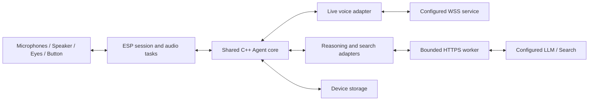

# Agent architecture

**English** | [简体中文](architecture.zh-CN.md)

Pikoo separates device-owned decisions from external inference. The ESP32 is responsible for the lifecycle and every local mutation; remote services return model output or retrieved information. Credentials, tools and state are not managed by a Pikoo application server.

## Modules and responsibilities

| Module | Responsibility | Boundary |
|---|---|---|
| `pikoo_config` | Parse and validate AgentConfig and full endpoints | Reject unsupported protocols before connecting |
| `LiveAgent` | Voice events, delegation and classified context | Provider messages cannot directly mutate NVS |
| `BackendAgent` | Reasoning rounds and tool orchestration | Bounded deadline, rounds and result sizes |
| Provider adapters | Responses, Chat Completions, search normalization | Protocol selection is explicit |
| `HttpResponse` | Incremental bounded HTTP parsing | Handles network fragments independently of JSON meaning |
| ESP network worker | Verified TLS and request execution | Returns tagged results; does not own family state |
| Storage | Configuration and two-slot family snapshots | Different partitions and export rules |
| Board/audio/eyes | I²S, wake frontend, display and button handling | Shared logic is separated from ESP drivers |

Shared implementation is in `firmware/components/pikoo_core`; ESP integration is in `firmware/main`. Native tests exercise the same core. Desktop execution does not reproduce ESP scheduling, heap fragmentation or radio behavior.

## A delegated turn

1. Local wake transitions to a voice connection; readiness enables audio upload.
2. Live emits classified transcripts and a client delegation request.
3. The Agent creates a backend task from bounded context, using the delegation identity.
4. The configured LLM can answer or request a registered tool. The ESP validates arguments and executes local mutations; search is delegated to the selected search adapter.
5. Tool results return to the LLM within the task's round/deadline budget.
6. The completed result returns to Live under the same delegation ID for speech. Errors remain errors; a failed write is not reported as success.

A successful persisted write is not rolled back when subsequent speech fails. Call-ID receipts protect retried events within the retained window. The architecture does not promise global semantic deduplication.

## Scheduling and cancellation

Realtime audio tasks do not wait synchronously for backend HTTP. At most one backend HTTP request runs at once. Each task permits four model rounds and 30 seconds overall; search has an eight-second deadline. Responses are bounded to 64 KiB and normalized search results to 16 KiB.

Only the session task changes family state. Worker results carry request tokens; cancellation invalidates the token before late data is handled. Playback epochs prevent old queued samples from being replayed after interruption. Farewell cancels backend work while allowing goodbye playback to drain.

## Transport and memory

All service connections verify TLS certificates. Direct networking is the default. Optional HTTPS CONNECT adds a separately authenticated outer connection; service TLS remains end-to-end. Redirects are not followed. Within one delegation, a fully consumed HTTP connection may be reused only for the same origin and proxy settings. Cancellation, incomplete responses, `Connection: close`, a new task or 15 seconds idle discard it. Failed POSTs are not automatically replayed.

cJSON allocations prefer PSRAM on ESP32-S3, reserving internal memory for Wi-Fi, TLS and DMA. PCM16 mono supports 16/24 kHz with a 900 ms prebuffer and bounded PSRAM queue. USB status exposes internal-heap low water, largest free block, backend stack headroom and queue peaks. These are board metrics, distinct from host RSS.

## Storage boundaries

`agent_secret` contains replaceable ordinary-NVS service settings. `agent_data` uses two snapshot slots for lists, memories, bounded context and receipts. Volume/orientation are separate device settings. See [context and memory](context-memory.md) for limits and [security](../SECURITY.md) for physical-access and provider boundaries.

[Lifecycle](conversation-lifecycle.md) · [Tools](family-tools.md) · [Development](development.md)
