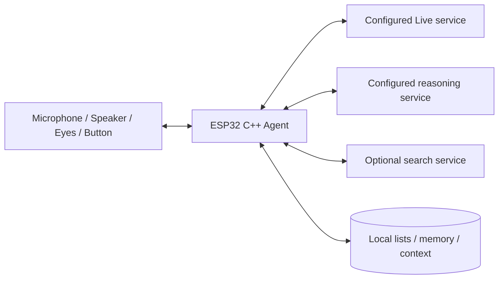

# Architecture

**English** | [简体中文](architecture.zh-CN.md)

## Ownership and flow

The device owns its lifecycle, tool registry, task state, cancellation and persistence. The Live adapter establishes a configured WSS session and uses **client delegation**. Classified transcripts and bounded context form a backend task. The configured LLM selects tools; the ESP validates and executes them, feeds results back, and returns verified facts to Live with the same delegation ID.

`pikoo_core` is platform-neutral: configuration, Live protocol, reasoning/search adapters, HTTP parsing and family state. `firmware/main` supplies verified TLS, an asynchronous HTTP worker, NVS and hardware. Only the session task modifies family state; the network worker returns immutable results tagged with request tokens.

## Concurrency and bounds

Realtime audio never waits for HTTP work. One backend HTTP request runs at a time, with four model rounds and a 30-second overall task deadline; search has an eight-second deadline. Cancellation invalidates tokens, clears pending work and discards late results. HTTP responses are bounded to 64 KiB; normalized search results to 16 KiB. API redirects are not followed.

Within one delegation, the worker may reuse one fully consumed HTTP connection to the same HTTPS origin and proxy configuration. Each round has a separate result token; the delegation scope stays stable across LLM/search rounds. A new task, cancellation, an incomplete response, `Connection: close` or 15 seconds of inactivity discards the connection. Every request constructs its own Authorization header; credentials are not inherited from an earlier request. Failed POSTs are not automatically replayed.

On ESP32-S3, cJSON nodes and buffers prefer PSRAM, retaining internal memory for Wi-Fi, TLS and audio DMA. The USB status reports internal-heap low water, largest free block, backend stack headroom and observed audio-queue peaks. These are board measurements, separate from native simulator RSS and timings.

Audio is PCM16 mono at 16 or 24 kHz, with a 900 ms prebuffer and bounded PSRAM queue. Epoch changes discard old playback. The microphone stays local while idle and is disabled while muted. Idle and farewell release the voice connection.

## Persistence

Service configuration lives in replaceable ordinary `agent_secret` NVS. Family data uses two slots in `agent_data`: shopping/todo/memory each have 32 entries of at most 512 UTF-8 bytes, context has 12 fragments and write receipts have 32 IDs, within a 24 KiB snapshot. USB family export excludes credentials. The existing volume and orientation settings are retained separately.

[Agent behavior](agent.md) · [Service configuration](configuration.md) · [Development](development.md)
