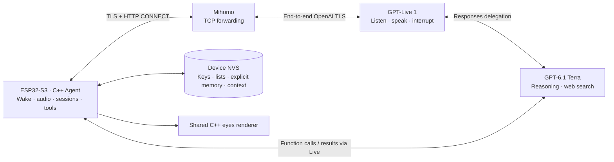

# Architecture

**English** | [简体中文](architecture.zh-CN.md)

The ESP32-S3 runs the C++ session, tool and storage core. Standby audio stays local. The ESP verifies Mihomo TLS, authenticates to the proxy, creates CONNECT to api.openai.com:443, then verifies OpenAI TLS inside that tunnel and sends its project key. The listener rejects other destinations.

GPT-Live 1 handles speech. Native Responses delegation uses GPT-6.1 Terra for reasoning, tool selection and hosted search. Decisions classifies input fragments before they enter persistent context. Model inference runs on OpenAI.

Capture, AEC, wake and I²S retain their board implementation. PCM defaults to 16 kHz mono, with a selectable 24 kHz path and streaming conversion. Playback retains a bounded 900 ms prebuffer and generation-based cancellation. Reconnection never replays queued old audio.

Device NVS stores replaceable OpenAI and proxy credentials separately from family data. Credentials are excluded from firmware and family exports. Family snapshots are limited to 24 KiB, with 32 entries per group, 512 UTF-8 bytes per entry, 12 recent text entries and 32 durable tool receipts. Two slots provide interrupted-write recovery. Automatic learning is disabled; corrections/deletion invalidate old text context.

The macOS console avoids control-line changes on open. Firmware reattaches USB once at startup to recover the observed native USB reset failure. Detailed Agent traces are disabled by default. Desktop measurements and board TLS/I²S measurements are reported separately.

The GCP 7 Gateway remains for older devices, graphical simulator voice and rollback. Its server-side memory and summarization are separate from local mode. See the [local deployment and verification record](local-agent.zh-CN.md).
