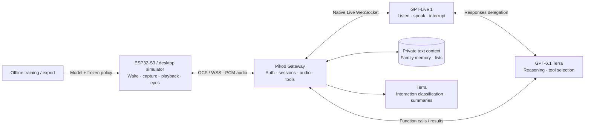

# Architecture

**English** | [简体中文](architecture.zh-CN.md)

## Audio and control

The ESP32 performs local microphone processing and wake inference. Standby audio stays local. After wake, the device authenticates to `wss://YOUR_HOST/api/realtime` using a revocable device token. JSON/Base64 PCM16 and lifecycle messages use GCP 7 with Pikoo continuous-audio capabilities.

The current native Live path uses **16 kHz mono PCM16 in both directions**. The Gateway negotiates the actual rate; compatibility output may be 24 kHz and uses the device's streaming resampler. Continuous audio has no per-answer `audio.done`: stream identity, generation, sequence and actual playback telemetry govern cancellation, expressions and idle. Old generations are discarded.

## Online models

`server/host.mjs` composes Qwen Audio Agent 2.0.1 with Pikoo's native `gpt-live-1` Provider. Live handles hearing, Chinese speech, interruptions and selective replies. Responses delegation uses `gpt-6.1-terra` for reasoning and tool selection. Separate Terra requests classify interaction and organize memory; classification labels never become spoken replies. `AGENT_PROTOCOL=none` does not disable these original adapters.

## Persistence and isolation

| State | Purpose | Owner |
|---|---|---|
| Recent text context | Resume the current topic after sleep/reconnect | Server, family owner |
| Topic digests | Bound context size and retrieve past topics | Server, family owner |
| Markdown memory | Durable facts, preferences, corrections and deletions | Server, family owner |
| Notes/lists | Explicit shopping and to-do operations | Server, family owner |
| Device session identifier | Refer to a logical conversation | Device NVS; expires |
| Wake model + policy | Offline sound-to-trigger decision | Device; shared with host tests |

Provider keys and personal profiles stay on the server. The device stores Wi-Fi and its own credential. Models are not a database: persistence comes from Gateway storage and tools. Audio is streamed to the selected provider during a conversation; this project does not publish recordings.

## Offline components

`pikoo_eyes` takes state, time, seed, gaze and volume and produces two RGB565 frames. The simulator launches its native renderer separately from the audio path. Training prepares the same 16 kHz microfrontend features, trains/quantizes the wake model and exports a model-bound decision policy. It is not part of live conversation.
