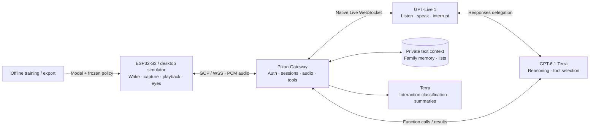

# 整体架构

[English](architecture.md) | **简体中文**

## 音频与控制

ESP32 完成本地采音处理和唤醒推理，待机声音不上行。唤醒后使用可撤销设备凭证连接 `wss://YOUR_HOST/api/realtime`。音频采用 JSON/Base64 PCM16，会话使用 GCP 7 与 Pikoo 连续音频能力扩展。

当前原生 Live 路径双向均为 **16kHz、单声道 PCM16**。Gateway 协商实际采样率；兼容输出可能为 24kHz，由设备流式重采样。连续音频没有逐回答的 `audio.done`，使用流标识、播放代次、序号和真实播放状态处理清空、表情与空闲。旧代次音频丢弃。

## 在线模型

`server/host.mjs` 组合 Qwen Audio Agent 2.0.1 和 Pikoo 原生 `gpt-live-1` Provider。Live 负责听说、中文回复、打断与选择性回应；Responses 委派给 `gpt-6.1-terra` 完成推理和工具选择。独立 Terra 请求做互动分类及记忆整理，分类标签不进入语音播报。`AGENT_PROTOCOL=none` 不会禁用这些适配能力。

## 持久化与隔离

| 状态 | 用途 | 保存位置 |
|---|---|---|
| 近期文字 | 休眠、断线后的当前话题续接 | 服务端，按家庭 owner 隔离 |
| 话题摘要 | 限制上下文大小并回顾过去话题 | 服务端，按家庭隔离 |
| Markdown 记忆 | 长期事实、偏好、纠错与删除 | 服务端，按家庭隔离 |
| 清单 | 显式购物、待办增删查 | 服务端，按家庭隔离 |
| 设备会话标识 | 关联逻辑会话，有效期内恢复 | 设备 NVS |
| 模型与策略 | 离线声音到唤醒的判定 | 设备及主机测试 |

模型密钥和私人资料留在服务端；设备只保存 Wi-Fi 与自己的凭证。长期保存依靠 Gateway 存储和工具，不是模型自动变成数据库。对话期间音频发送到所选模型服务，本项目不公开录音。

## 离线组件

`pikoo_eyes` 根据状态、时间、随机种子、视线和音量生成两块 RGB565 画面。模拟器把原生绘制进程与语音链路分开。训练工程使用相同 16kHz microfrontend，负责训练、量化和导出模型绑定策略，不参与在线对话。
