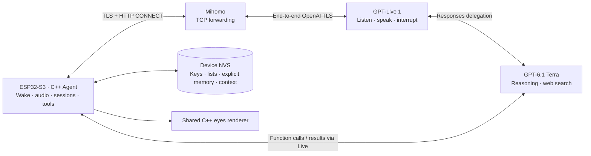

# 整体架构

[English](architecture.md) | **简体中文**

## 本地会话与云端模型

ESP32-S3 上的 C++ 核心管理会话、工具和存储。待机声音不上行，唤醒后由 ESP 验证 Mihomo 的 TLS 证书并使用独立代理凭证建立 CONNECT 隧道，再验证 api.openai.com 的内层 TLS、发送 OpenAI 项目密钥。Mihomo 的入口只允许 api.openai.com:443。

GPT-Live 1 负责听说与自然轮次，原生 Responses 委派使用 GPT-6.1 Terra 完成推理、工具选择与托管搜索。Decisions 对输入转写做互动分类；无法判定为明确互动的输入不写入本地上下文。ESP 不是离线语言模型。

## 音频和资源

采音、AEC、唤醒和 I²S 沿用原实现。默认双向 16 kHz 单声道 PCM16，可配置 24 kHz 并使用流式重采样。播放有界预缓冲保持 900 ms；代次与取消逻辑丢弃旧队列。断线重连重建模型连接，不重播旧音频。

USB 控制台避免 macOS 打开端口时改写控制线，并在应用启动时重连 USB 外设。诊断默认关闭详细 Agent 事件追踪。板上 TLS 堆和 I²S 指标与桌面模拟指标分开记录。

## 本机持久化

| 状态 | 保存位置与边界 |
|---|---|
| OpenAI 和代理凭证 | 独立普通 NVS，USB 更新或删除，不进入镜像或家庭数据导出 |
| 购物、待办、显式记忆 | 独立数据 NVS，每组 32 项、每项 512 UTF-8 字节 |
| 最近文字上下文 | 最多 12 条，流式文本按时间线分组 |
| 写入去重 | 最近 32 个工具调用 ID，与数据一起提交 |
| 数据快照 | 总上限 24 KiB，双槽提交与恢复 |

不自动学习新家庭事实，不做声纹身份推断。清单与记忆独立，修正和删除清除旧上下文，避免旧信息被重新引入。通过 USB 导出、导入和迁移，私有备份包含家庭内容，应留在本机。

## 兼容组件

`server/host.mjs` 与 GCP 7 模式保留，用于旧设备、桌面图形模拟器和回滚。其服务端记忆、摘要和多用户逻辑只适用于该模式。端侧模式不运行远程 Qwen Audio Agent。`pikoo_eyes` 仍由 ESP 与桌面共用，训练工程离线运行。

[本地部署、测量和验收记录](local-agent.zh-CN.md)
