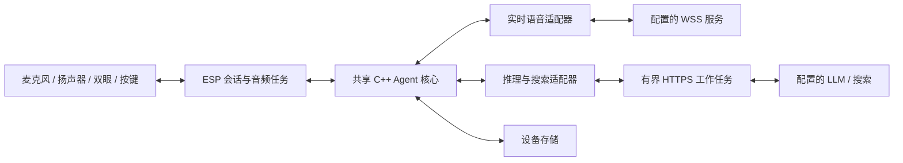

# Agent 架构

[English](architecture.md) | **简体中文**

Pikoo 将设备决策与外部推理解耦。ESP32 负责会话生命周期及每次本地数据修改，远端服务返回模型输出或检索信息。凭证、工具和状态不依赖 Pikoo 应用服务器管理。

## 模块与职责

| 模块 | 职责 | 边界 |
|---|---|---|
| `pikoo_config` | 解析校验 AgentConfig 与完整地址 | 连接前拒绝未知协议 |
| `LiveAgent` | 语音事件、委派、分类上下文 | 服务事件不能直接改 NVS |
| `BackendAgent` | 推理轮次与工具编排 | 限制期限、轮次、结果大小 |
| 服务适配器 | Responses、Chat Completions、搜索标准化 | 显式选择协议 |
| `HttpResponse` | 增量解析有界 HTTP | 网络分片与 JSON 含义分开处理 |
| ESP 网络工作任务 | 验证 TLS 并执行请求 | 返回带标识结果，不拥有家庭状态 |
| 存储 | 配置与家庭数据双槽快照 | 分区、导出规则独立 |
| 板级、音频、双眼 | I²S、唤醒前端、显示、按键 | 共享逻辑与 ESP 驱动分离 |

共享实现在 `firmware/components/pikoo_core`，ESP 集成在 `firmware/main`。原生测试使用同一核心，但桌面执行不能复现 ESP 调度、堆碎片和无线电行为。

## 一次委派的过程

1. 本地唤醒启动语音连接，就绪后允许上传音频。
2. Live 发出分类转写和客户端委派请求。
3. Agent 使用有界上下文和委派标识创建后端任务。
4. LLM 可以回答或调用注册工具。ESP 校验参数并执行本地修改；搜索由独立适配器处理。
5. 工具结果在轮次与总期限限制内回传 LLM。
6. 最终结果携带同一委派 ID 返回 Live 进行语音输出。失败如实传递，写入失败不能宣称成功。

已经提交成功的数据不会因后续语音失败自动撤回。调用 ID 回执在保留窗口内防止重复事件执行，不承诺对所有语义相同的请求全局去重。

## 调度与取消

实时音频任务不等待后端 HTTP。最多同时执行一个后端 HTTP 请求，每项任务最多四轮模型调用、总期限 30 秒，搜索期限 8 秒。HTTP 响应上限 64 KiB，标准化搜索结果上限 16 KiB。

只有会话任务可以修改家庭状态。工作任务结果携带请求标识，取消时先使标识失效，再处理迟到数据。播放代次避免插话后重播旧样本。告别立即取消后端工作，同时允许告别音频排空。

## 网络与内存

所有服务验证 TLS 证书，默认直连。可选 HTTPS CONNECT 建立独立鉴权的外层连接，服务 TLS 仍端到端。API 不跟随重定向。同一委派内，完整消费后的连接仅在同源且代理配置一致时复用；取消、不完整响应、`Connection: close`、新任务或空闲 15 秒会丢弃连接。失败 POST 不自动重放。

ESP32-S3 上 cJSON 优先分配 PSRAM，为 Wi-Fi、TLS 和 DMA 留出内部内存。音频为单声道 PCM16，支持 16/24 kHz，使用 900 ms 预缓冲与有界 PSRAM 队列。USB 状态提供内部堆低水位、最大连续块、后端栈余量和队列峰值；这些板上指标与桌面 RSS 不同。

## 存储边界

`agent_secret` 使用可替换的普通 NVS 保存服务设置；`agent_data` 使用双槽快照保存清单、记忆、有界上下文与回执。音量和方向是独立设备设置。容量见[上下文与记忆](context-memory.zh-CN.md)，物理访问和服务商边界见[安全说明](../SECURITY.zh-CN.md)。

[生命周期](conversation-lifecycle.zh-CN.md) · [工具](family-tools.zh-CN.md) · [开发](development.zh-CN.md)
