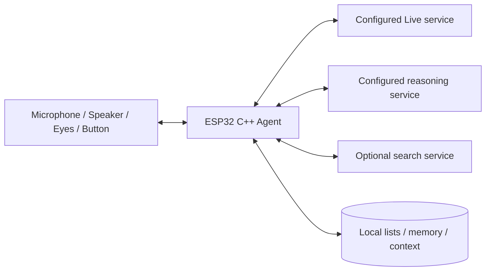

# Agent 架构

[English](architecture.md) | **简体中文**

## 职责与数据流

设备负责生命周期、工具注册、任务状态、取消和持久化。Live 适配器连接配置的 WSS 服务，使用**客户端委派**。经互动分类的转写和有界上下文形成后台任务，由独立 LLM 选择工具；ESP 校验、执行并回传工具结果，最后以原委派 ID 向 Live 返回已确认事实。

`pikoo_core` 不依赖板卡：包含配置、Live 协议、推理与搜索适配、HTTP 解析和家庭状态。`firmware/main` 提供校验证书的 TLS、异步 HTTP 工作线程、NVS 和硬件。只有会话线程修改家庭数据，网络线程仅返回带请求令牌的结果。

## 并发与资源边界

实时音频不等待 HTTP 请求。后台最多同时执行一个 HTTP 请求；每任务最多四轮模型调用、总期限 30 秒，搜索期限 8 秒。取消会失效请求令牌、清空待执行任务，迟到结果不写数据、不播报。HTTP 响应最多 64 KiB，标准化搜索结果最多 16 KiB；API 请求不自动跟随重定向。

音频为 16 或 24 kHz 单声道 PCM16，保留 900 ms 预缓冲和有界 PSRAM 播放队列；代次变化丢弃旧播放。待机麦克风数据不上云，静音时关闭采集。空闲和告别释放语音连接。

## 本地保存

服务配置位于可覆盖的普通 `agent_secret` NVS。家庭数据在 `agent_data` 双槽保存：购物、待办、记忆每组最多 32 项，每项最多 512 UTF-8 字节；短期上下文最多 12 个文本片段，写入回执最多 32 个 ID，快照上限 24 KiB。USB 家庭数据导出不含凭证；音量与屏幕方向另行保留。

[Agent 行为](agent.zh-CN.md) · [服务配置](configuration.zh-CN.md) · [开发指南](development.zh-CN.md)
