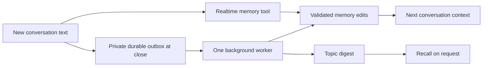

# Context, memory and Beijing time

**English** | [简体中文](context-memory.zh-CN.md) · [Architecture](architecture.md)

Pikoo uses the pinned `qwen-audio-agent@2.0.1` runtime, with Pikoo adapters for session lifetime and reliable background delivery. It does not copy another assistant's private memory system.

| Layer | Persistence and use |
|---|---|
| Assistant and family settings | Private server `ASSISTANT.md` and `USER.md`; no household information in firmware or public sources |
| Current topic | Device NVS conversation identifier, reused after disconnect, mute, reboot and automatic sleep within its 24-hour window; recent server text is restored before voice readiness |
| Durable facts and preferences | Private Markdown `MEMORY.md` and `USER.md`, accessed by the official `memory` tool and validated background extraction |
| Past topics | Official session digest/`recall`: bounded topics and a short gist, retained for up to 90 days, not a full recording |

The server projection retains approximately 40 recent messages / 3,500 characters for provider restoration. Gateway session TTL is aligned to 24 hours. This recovers semantic context, not untranscribed speech or unfinished playback. Explicit End or farewell creates a new conversation; shared long-term memory survives it. Automatic 30-second sleep stops upload and closes the eyes without clearing the topic. USB maintenance mutes before releasing the monitor; it must not send explicit End before an upgrade/reset.

## Remembering without a command

A naturally stated, stable shared-family fact or long-term decision can be saved proactively. A “remember” command is not required. Background extraction also covers overlooked statements, including a short conversation with one meaningful user turn. Greeting-only sessions do not create model requests.

No speaker identity is inferred. Anonymous “I” statements are not assigned to a family member; personal preferences need an explicitly identified subject. Fiction, test stories, guesses and secrets must not become family facts. Inferred profile learning remains disabled. Extraction still uses upstream document boundaries, exact edits, revisions, sensitive-content checks and owner write serialization. “Processed” is not a claim that every sentence was saved.

`context-learning.mjs` persists bounded pending text before consuming observations: at most 100 jobs, 40 messages / 6,000 characters per job and a seven-day pending lifetime. File mode is 600. No PCM is saved. A single worker spaces calls by at least 15 seconds. Both extraction and summarisation use a 45-second deadline. Failures remain pending with backoff; quota failures pause calls for at least 15 minutes. No paid fallback is enabled. The configured background model is `gemini-3.5-flash-lite`; realtime remains `gemini-3.8-live`.

Explicit memory edits invalidate queued and in-flight older learning. On restart, jobs with changed memory revisions are discarded. Corrections/deletions conservatively clear that owner's previous topic index, including late summaries; this can remove unrelated old topic summaries too. Subsequent summaries use new post-edit observations. Original conversation journals are separate and are not erased by a memory edit. Historical failed observations are not blindly reprocessed.

## Chinese-only output

As requested on 2026-10-25, realtime spoken and written replies use Mandarin Chinese only, including English input, English-practice requests, tool summaries and resumed conversations. Necessary proper names such as Pikoo retain their established spelling. Background speech and silence still follow quiet companion mode; clarification, when appropriate, is in Chinese. Earlier bilingual history does not override the current policy.

Every new or restored Live connection receives the same system instruction, aligned with the persona template. This follows [Google's native-audio language guidance](https://ai.google.dev/gemini-api/docs/live-api/capabilities#supported-languages), without unsupported language codes or an invented language array. It is a model instruction, not a deterministic audio-language filter; human listening acceptance remains separate.

Historical bilingual-policy validation (superseded by the 2026-10-25 Chinese-only policy): on 2026-10-20, all 20 server software checks passed. Five real Google Live checks passed on one connection using the deployed provider and service UID: Mandarin, English, an English-practice request in Mandarin, bilingual teaching, and a request for a third language. This direct-provider check used text input and inspected generated audio and its transcript; audio was discarded and no household gateway history or memory was created. It is not microphone or hardware listening acceptance. Ambient companion mode was not enabled.

2026-10-25: the Chinese-only policy was deployed after 43/43 server checks and four isolated real Google Live cases: Chinese input, English input, an explicit English-practice request, and a new connection seeded with earlier English conversation. Each generated audio with a Chinese transcript. Audio was discarded; household history/memory and firmware were not modified. See the [validation record](../server/reports/chinese-only-20261025.json).

## Time and operations

All Pikoo clients specify `Asia/Shanghai`. Each provider connection includes a server-generated Beijing clock snapshot. Current time/date/weekday and relative-date questions use the official `get_current_time` tool; a connection snapshot is not a continuously current clock. The host clock must be NTP-synchronised.

Authenticated `GET /api/pikoo/context-status` returns only the owner's queue/digest status, without text. Back up the private configuration, memory documents, digest pool, journals and outbox together. Gateway lease paths follow the configured state directory so isolated verification does not share household storage.

## Verification and sources

On 2026-10-19, authenticated real-service tests recovered synthetic facts after a disconnected connection reused its ID; a new-ID control did not know the random fact. An isolated gateway using the same provider, service user and proxy passed natural saving, new-session recall, correction, deletion, prevention of reintroduction and a current-time tool call. A separate real text-model extraction saved one ordinary fact without a realtime memory-tool call. Earlier `gemini-3.8-flash` 503 failures are retained, not recast as successes. Deterministic tests cover persisted retry, quota backoff, concurrent edits, late summaries, restart revision checks and the UTC-to-Beijing date boundary. The CTX1 board slept automatically after about 43.6 seconds, then reused the same gateway identity on wake. A controlled reset also reused its identity after fixing the USB tool, which had previously sent explicit End before releasing the monitor. These runs counted no playback supply gaps. Voice-wake recall and long-term reliability remain separate.

Official references: [memory](https://github.com/QwenAudio/qwen-audio-agent/blob/v2.0.1/docs/reference/memory.md), [provider boundaries](https://github.com/QwenAudio/qwen-audio-agent/blob/v2.0.1/docs/reference/memory-provider.md), [architecture](https://github.com/QwenAudio/qwen-audio-agent/blob/v2.0.1/docs/architecture/deep-dive.md), [Google pricing](https://ai.google.dev/gemini-api/docs/pricing). Fixed-version private composition hooks are guarded by tests; review them before upgrading the dependency.
