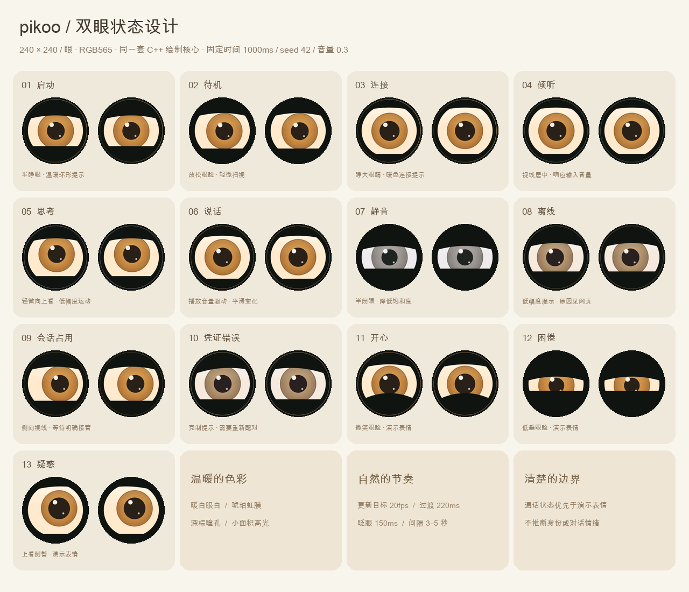

# Pikoo 双眼设计与本机试用

当前目标板为已购买的 **ESP32-S3-DualEye-LCD-1.28，Wi-Fi、非触摸双圆屏版**。本轮交付原生图形组件和本机网页；完整双屏驱动、音频参考通道、实板 AEC 与可打印外壳仍在到板阶段完成。现有固件的板级驱动仍属于 1.83-EN 基线，不能直接给双眼板烧录。



## 试用

本机入口：`http://127.0.0.1:8793/dualeye`。原版首页 `/` 和独立 `/wake-test` 保留。

在本次交付目录中双击“启动Pikoo双眼模拟器.command”，保持终端窗口运行；双击“停止Pikoo双眼模拟器.command”或在启动窗口按 Ctrl+C 停止。启动工具检查运行环境、编译画面核心、加载仓库外的私密配置与 V5 模型。端口占用时显示原因，停止工具仅结束它自身管理且进程身份匹配的服务。

1. 先看休息、开心、困倦、疑惑。点击“查看实际像素”显示两块 240×240 CSS 像素的圆屏；浏览器缩放与系统像素密度仍可能影响物理尺寸。
2. 点击“唤醒 Pikoo”，等到“我在听”后先发送一句文字。打开页面和点击唤醒均不会自动开启麦克风。
3. 勾选“开启本机麦克风”，由你自己允许浏览器授权。待机时说“你好皮酷”，检测到后连接服务器，再等“准备好了，请说话”。首版不保证唤醒词后紧接的第一句话被完整保留。
4. 连续说话无需重复唤醒。播放中可以插话；“停止当前回答”立即清空已排队声音。“结束对话”回到待机，30秒无用户活动且无回答时也自动结束。
5. “关闭麦克风”停止采音与上传；重新启用后需再次勾选采音。断线清空旧音频并退避重连。占用时由你明确点击“接管其他设备的会话”。

浏览器音频前处理用于电脑试用，不能证明 ESP32 AEC 或扬声器效果。网页外壳只是外观概念，没有电路固定点、散热、麦克风孔和声学结构，不能据此直接打印最终外壳。

## 可复现运行

Node.js 24 LTS、C++17 编译器，以及 `server/` 中已安装的固定依赖。唤醒另需训练说明里的 Python 环境。网页不用打包框架、图片动画库、Muse 云或外部字体服务。

```sh
cd server
npm ci --ignore-scripts
cd ..
bash tools/build-eyes.sh
PIKOO_SIM_PORT=8793 node firmware/simulator/server.mjs
```

上面是离线测试音模式。真实语音需要设置以下变量；配置文件权限为 `600`，只包含 `endpoint` 与设备 `token`，不进入仓库：

```sh
export PIKOO_SIM_CONFIG=/absolute/private/simulator.json
export PIKOO_WAKE_PYTHON=/absolute/venv/bin/python
export PIKOO_WAKE_MODEL=/absolute/private/nihao_pikoo.tflite
export PIKOO_WAKE_LABEL='你好皮酷 V5（本机受限模型）'
export PIKOO_SIM_PORT=8793
node firmware/simulator/server.mjs
```

本机已有环境可使用 `bash tools/start-dualeye.sh` / `bash tools/stop-dualeye.sh`。其他电脑设置 `PIKOO_NODE`、以上 Python/模型/配置路径；`PIKOO_SIM_MOCK=1 bash tools/start-dualeye.sh` 明确启动离线模式。缺少 V5 时不会静默换成仓库内较旧的基线模型。

## 图形与状态

奶油色圆润身体、短耳朵和深色眼框，屏幕是暖白眼白、琥珀虹膜、深棕瞳孔和小面积高光。左右眼共享视线目标并保留很小的差异，指针可以在预览区引导视线。

| 状态 | 表现 |
|---|---|
| 启动、连接 | 半睁到睁大眼，温暖的低幅度连接提示 |
| 待机 | 放松眼睑，轻微扫视，间歇眨眼 |
| 倾听 | 视线居中、眼睑打开，按实际输入 RMS 平滑变化 |
| 思考 | 轻微上看、低幅度周期运动 |
| 说话 | 使用 WebAudio 播放链路 RMS，平滑改变瞳孔与眼睑 |
| 静音 | 半闭眼、低饱和度，网页明确显示文字 |
| 离线、占用、凭证错误 | 克制提示，具体原因和操作在网页侧栏 |
| 开心、困倦、疑惑 | 仅供待机演示；通话立即恢复真实状态 |

更新目标20fps、状态过渡220ms、眨眼150ms、相邻眨眼间隔3–5秒。固定动画时间、种子和音量可生成重复画面。浏览器后台会暂停画面请求；恢复后请求当前时间，避免补播旧帧。表情不判断家庭成员身份或对话情绪。

## 同一核心在电脑与固件复用

`firmware/components/pikoo_eyes/` 是 C++17 组件，不依赖 ESP-IDF、LVGL、网络或堆分配。`Animator::update(Input)` 接收状态、毫秒时间、种子、归一化视线与音量；`render(Pose, side, buffer, count)` 写出每眼57,600个 RGB565 像素。缓冲区由调用方提供，每眼115,200字节；圆外像素为黑。

```cpp
#include "pikoo_eyes.hpp"
// On ESP32, allocate buffers in PSRAM; do not put them on a FreeRTOS task stack.
pikoo::eyes::Animator animator;
auto pose = animator.update({pikoo::eyes::State::Listening, uptime_ms, 42, rms, 0, 0});
pikoo::eyes::render(pose, 0, left_pixels, pikoo::eyes::EyePixels);
pikoo::eyes::render(pose, 1, right_pixels, pikoo::eyes::EyePixels);
```

同一 `pose` 同时绘制两眼；板级驱动负责独立 CS、方向、旋转和屏幕所需的字节交换。建议 UI 任务使用可复用 PSRAM 缓冲与有界提交队列，并使音频任务优先。此次 ESP32-S3 编译证明组件能被工具链使用；20fps 的实板速度、SPI DMA 约束、总资源占用仍需到板测量。不能把主机性能外推为 MCU 性能。

本机 `eyes-host.cpp` 是该核心的薄适配层。输入一行 `stateNumber timeMs seed level gazeX gazeY`，输出左右连续的 **230,400字节 RGB565LE**。`--snapshot STATE TIME FILE.ppm` 输出480×240设计图。固件内部使用 `uint16_t`，本机流明确按小端打包，不借用内存字节序。

Node 为每个 `/eyes` 连接管理独立绘制进程；浏览器完成绘制后发送 `eyes.ack`。始终只有一帧未确认和一个最新姿态，慢客户端不会积累旧帧。异常进程、超时、无效输入只关闭图形通道，语音 `/device` 独立工作，页面显示原因并重试画面。Host / Origin 检查覆盖全部本机通道，服务只监听127.0.0.1；Google Key、家庭资料和设备 token 不发到网页。

## 检查与记录

```sh
bash tools/test-eyes.sh
node --test firmware/simulator/*.test.mjs
node tools/stress-dualeye.mjs 1800
# Optional design sheet generation (Pillow):
python tools/render-eyes.py
```

离线模式侧栏还有“运行30分钟本机检查”，测试真实 WebAudio 调度与两眼绘制，输出静音，不采集麦克风、不访问远程语音。保持页面前台可测20fps；记录后台秒数、帧数、音频块、取消和断线次数。手动停止可随时结束。

明确配置真实服务后，可用 `node tools/check-dualeye-live.mjs /private/pcm-directory` 检查三轮中文输入、取消、合成语音插话和重新连接。唤醒到会话就绪另可运行 `node tools/check-wake-to-session.mjs /private/16khz-mono-pcm16.wav`，只在本地唤醒事件后连接远程服务。

语音检查目录需要 `voice1.pcm`、`voice2.pcm`、`voice3.pcm`、`barge.pcm`，均为16kHz单声道PCM16，小端。这些音频不放入仓库。结果仅记录计数，不保存对话正文或密钥。

本轮实际通过项和未通过项见 [双眼验收记录](dualeye-validation.md)。后续先接两屏和音频参考信号，再测 AEC、童声唤醒、自然打断及72小时实板运行。

## 参考与原创边界

借鉴 [Muse 模拟器](https://github.com/facebookincubator/muse-gadget-sdk/blob/main/esp32/simulator/README.md) 中“核心渲染复用、独立状态与可重复截图”的组织思路以及克制的动画节奏。Pikoo 的眼睛、美术、网页壳与绘制实现均自行编写，没有复制 Jollybot 素材或 Muse 绘制代码。板型资料以[微雪官方文档](https://docs.waveshare.net/ESP32-S3-DualEye-LCD-1.28/)为准，硬件到货后再核实具体版本。许可证说明见 [THIRD_PARTY.md](../THIRD_PARTY.md)。
