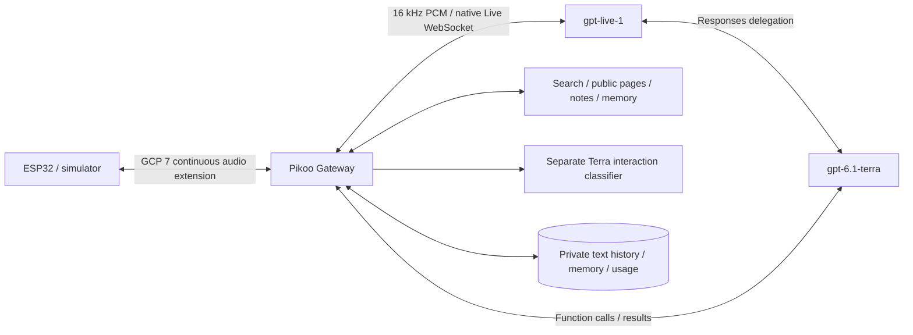

# OpenAI Live + Terra integration

**English** | [简体中文](openai-live.zh-CN.md)

Development preview, updated 2026-10-29. Native API and isolated tool tests have run; sustained device audio acceptance is still in progress. This is not the Realtime API with a renamed model.

2026-11-01 [network follow-up](reports/live-network-2026-11-01.json): repeated
Gateway→OpenAI TLS resets were reproduced. The deployed mitigation uses the
Taiwan exit, explicit IPv4 and `X25519:P-256` key-exchange groups; it does not pin
service IPs, disable certificate checks or cap TLS versions. Three short native
Live starts/closes and a Terra request succeeded, but household follow-up still
reported slow replies and reconnect displays. This is **not fully resolved**.

Local-only Live diagnostics now include accepted input counts, maximum input
RMS, transcript-event counts and the latest interaction decision. Sleep logs
include the reason and time since effective interaction, without speech text or
PCM. A temporary +12dB conversation-input comparison did not demonstrate an
improvement and was fully reverted; wake settings and output volume are unchanged.

An isolated `PIKOO_AUDIO_CAPTURE_BENCHMARK=ON` build supports a USB-triggered
four-second ADC/AFE comparison. It does not initialize networking, leaves the
amplifier off, and reads no samples until explicitly triggered. Capture buffers
stay in PSRAM during sampling, export afterward and are wiped; it accepts only
one capture per boot. Use a separate build directory and an explicitly confirmed
quiet synthetic-replay window; never collect household conversation implicitly.
The normal build tool explicitly disables this diagnostic. Compilation is not
hardware validation, and any resulting recordings remain private evaluation-only.

2026-11-01 16 kHz follow-up: server deployed and firmware `0.2.1-live16` flashed with app-only digest verification. The board negotiated 16 kHz and bypassed playback resampling; the user reported smooth sound and improved response speed. Server (60), simulator (25), C++ sanitizer checks and ESP-IDF build passed. This short check is not long-run stability acceptance; an isolated API probe still had a 1096 ms arrival gap. See the [actual results](reports/live-audio-16k-2026-11-01.json).

The later voice trial selects Coral at +12 dB after the initial +4 dB trial was reported too quiet and lacking energy, and the +6 dB trial improved enthusiasm but was still perceived as too quiet. Software and API acceptance are recorded separately from pending human listening: [voice trial record](reports/live-voice-style-2026-11-01.json). To restore the previous output settings, set the protected service environment to `PIKOO_LIVE_OUTPUT_GAIN_DB=0` and `PIKOO_LIVE_VOICE=marin`, then restart into a new session; the 16 kHz fix remains in place.

Later on 2026-11-01, a second user-supplied proxy subscription was compared using real Live streams. Its Singapore dedicated node passed two short streams (connect 1457–1573 ms, maximum arrival gap 337–358 ms) and Terra; the production UID-TUN check also passed (1358 ms connect, 338 ms maximum gap). It is now selected, with new U.S. and old Taiwan nodes retained for manual rollback. The short real-device follow-up saw a 201 ms maximum upstream gap; household listening and sustained stability remain pending. Subscription credentials stay private. See the [route comparison](reports/proxy-comparison-2026-11-01.json).

The later spoken-goodbye fix preserves assistant speech that preceded a delayed classifier result and waits for a bounded playback tail. Synthetic goodbye closed about 6.0 seconds after its utterance ended; discussing the word goodbye did not close the session. The old code fails the new timing regression; 68 server checks pass. Family microphone and eye-closing acceptance remain separate. Delivery instructions were reduced to a single everyday-conversation direction after exaggerated speech was reported. See the [actual farewell results](reports/live-farewell-2026-11-01.json).

## Configuration and deployment

Install the pinned dependencies with `npm ci --ignore-scripts` in `server/`. Deploy all server modules, not only `host.mjs`; do not modify the installed upstream package. Use Node.js 24 or newer. Put secrets in an owner-readable private environment file (0600), loaded by Node `--env-file` or systemd `EnvironmentFile` before the process starts. The example `server/deploy/openai-live.env.example` contains no credentials.

Set `PIKOO_VOICE_PROVIDER=openai-live`, `OPENAI_API_KEY`, and `AGENT_PROTOCOL=none`. Existing owner-scoped authentication, notes, safe URL retrieval and DeepSeek search settings remain in effect. Both model names are fixed. Live defaults to `marin`; `PIKOO_LIVE_VOICE` accepts the 31 built-in names in the official Live API schema (`LIVE_VOICES`); a name in the schema is not proof of tested Chinese speech quality. The household trial selects `coral` with natural, friendly, clearly projected everyday conversation while retaining quiet listening. Replies are Chinese, including when input is English. Terra uses Standard service tier, low reasoning and `store:false`. No automatic provider fallback or account top-up is performed.

This requires a firmware/simulator client advertising `pikoo.audio.continuous.v1`. Older clients are rejected with an upgrade message. Keep the private configuration and factory backup when upgrading the application partition. Do not change wake weights or speaker gain to troubleshoot Live transport.

## Audio and lifecycle

As of 2026-11-01, Live uses mono PCM16 at 16 kHz for both directions (`audio.format`). Device input is forwarded without resampling. Clients advertising `pikoo.audio.pcm16.v1` receive native 16 kHz output and updated ESP32 firmware plays it directly at its hardware rate. Older continuous-audio clients receive a statefully converted 24 kHz compatibility stream until upgraded; this keeps existing devices usable. Each `audio.delta.sampleRate` and `voice.ready.outputSampleRate` describes the actual client format. Playback prefill remains 900 ms, the fallback wait 1500 ms, and the queue is bounded to 30 seconds at either rate. Compared with 24 kHz, upstream audio payload is reduced by one third per direction; device downlink sees the same reduction only after upgrading. JSON/Base64 and transport overhead are additional. This does not resolve TLS failures, recognition, or proxy jitter by itself. The supported formats are documented in [OpenAI WebSockets](https://developers.openai.com/api/docs/guides/voice-websockets). Live audio remains continuous, including silence. `audio.delta` includes `streamId`, `generation`, `sequence` and `continuous:true`. It has no synthetic `audio.done`. Clients reject older generations and clear audio on cancellation/reconnection.

`pikoo.playback.status` reports stream/generation, queued milliseconds, DMA estimate, audible output and local speech activity. Firmware uses a bounded 900 ms startup buffer, with a 1500 ms wait limit, and re-buffers after starvation. The DMA field currently uses the existing bounded drain estimate; it is not a hardware readback of every played sample. A network gap is not treated as an answer boundary.

Explicit stop clears the device immediately and establishes a new native Live connection with saved text. Natural interruption remains Live-driven and requires physical validation with AEC and the playback buffer. Ordinary sleep keeps the logical conversation ID. Resume restores bounded saved text and summaries, not the original audio stream or unfinished sound.

## Idle, memory and tools

Terra classifies new transcript segments as directed interaction, background or unknown. At most one request runs per session, with a 5-second minimum request interval and a 5-second deadline; stale results are discarded. Silence does not trigger polling. Only directed user segments enter the automatic learning history. Classification assists idle/memory decisions; it does not gate each audio packet or guarantee no unwanted replies.

Idle is 60 seconds after a valid interaction/related reply, with at most 15 additional seconds for speech or uncertainty. Valid story playback and bounded tools protect ongoing work. Closing waits for the native close event; missing final usage is estimated. Background conversation must not hold a session indefinitely. Explicit farewell is context-classified rather than a keyword match.

Tool calls use existing permissions, owner scopes and fetch restrictions. Durable call-ID reservations prevent replay of the same call, including after a crash; an uncertain reservation must be queried before retrying. This does not claim exactly-once execution for different IDs that request the same operation. Late results cannot restart a closed transport.

Automatic memory and summary requests use Terra Responses and the existing persistent learning queue. Corrections/deletions invalidate old summaries through the existing memory adapter. A failed request remains visible/pending; it is not silently routed to Gemini. Long-session and household acceptance remain separate from isolated tests.

## Diagnostics and verification

- `GET /api/pikoo/live-status`: local-only authentication through SSH, aggregate Live/Terra usage, session state, upstream chunk arrival gaps and device playback telemetry. No extra public listener.
- Usage is a local estimate for this deployment, not an organization balance. Cumulative Live seconds are deduplicated; delegation, classification, summaries and memory are separated. Credit-cycle alerts are disabled for the current installation at the owner's request; quota errors are surfaced.
- Run `node --test server/*.test.mjs firmware/simulator/*.test.mjs` and `bash tools/test-core.sh`. API tests cost money and require explicit private credentials and an isolated gateway.
- `live-smoke.mjs` refuses production port 3101. It feeds synthetic text/silence and simulates playback telemetry; it is not a microphone, AEC or speaker test.
- `live-classification-eval.mjs` evaluates the versioned 60-case synthetic scene set. Its score is not household generalization evidence.
- USB diagnostics `eyes freeze`/`eyes resume` isolate graphics load. Freeze automatically expires after 120 seconds and does not change saved configuration.

See [actual test record](openai-live-validation.md). OpenAI is an external paid service governed by its own terms, outside the project's Apache-2.0 license. Official references: [Live](https://developers.openai.com/api/docs/guides/live), [delegation](https://developers.openai.com/api/docs/guides/live-delegation), [conversations](https://developers.openai.com/api/docs/guides/live-conversations).
