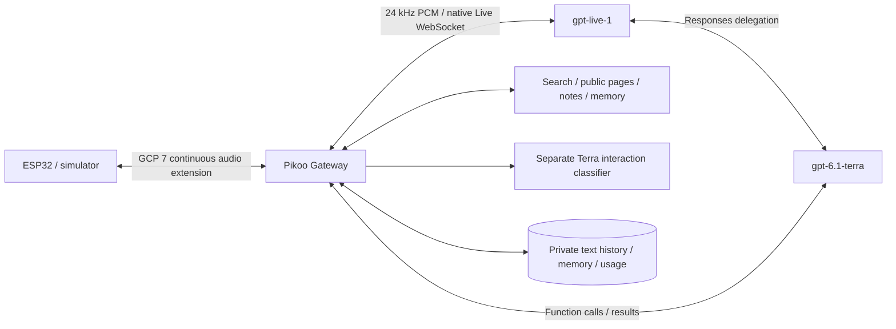

# OpenAI Live + Terra integration

**English** | [简体中文](openai-live.zh-CN.md)

Development preview, updated 2026-10-29. Native API and isolated tool tests have run; sustained device audio acceptance is still in progress. This is not the Realtime API with a renamed model.

## Configuration and deployment

Install the pinned dependencies with `npm ci --ignore-scripts` in `server/`. Deploy all server modules, not only `host.mjs`; do not modify the installed upstream package. Use Node.js 24 or newer. Put secrets in an owner-readable private environment file (0600), loaded by Node `--env-file` or systemd `EnvironmentFile` before the process starts. The example `server/deploy/openai-live.env.example` contains no credentials.

Set `PIKOO_VOICE_PROVIDER=openai-live`, `OPENAI_API_KEY`, and `AGENT_PROTOCOL=none`. Existing owner-scoped authentication, notes, safe URL retrieval and DeepSeek search settings remain in effect. Both model names are fixed. Live uses `marin`; replies are Chinese, including when input is English. Terra uses Standard service tier, low reasoning and `store:false`. No automatic provider fallback or account top-up is performed.

This requires a firmware/simulator client advertising `pikoo.audio.continuous.v1`. Older clients are rejected with an upgrade message. Keep the private configuration and factory backup when upgrading the application partition. Do not change wake weights or speaker gain to troubleshoot Live transport.

## Audio and lifecycle

The gateway continuously resamples device PCM16 from 16 to 24 kHz. Live returns continuous 24 kHz audio, including silence. `audio.delta` includes `streamId`, `generation`, `sequence` and `continuous:true`. It has no synthetic `audio.done`. Clients reject older generations and clear audio on cancellation/reconnection.

`pikoo.playback.status` reports stream/generation, queued milliseconds, DMA estimate, audible output and local speech activity. Firmware uses a bounded 900 ms startup buffer, with a 1500 ms wait limit, and re-buffers after starvation. The DMA field currently uses the existing bounded drain estimate; it is not a hardware readback of every played sample. A network gap is not treated as an answer boundary.

Explicit stop clears the device immediately and establishes a new native Live connection with saved text. Natural interruption remains Live-driven and requires physical validation with AEC and the playback buffer. Ordinary sleep keeps the logical conversation ID. Resume restores bounded saved text and summaries, not the original audio stream or unfinished sound.

## Idle, memory and tools

Terra classifies new transcript segments as directed interaction, background or unknown. At most one request runs per session, with a 5-second minimum request interval and a 5-second deadline; stale results are discarded. Silence does not trigger polling. Only directed user segments enter the automatic learning history. Classification assists idle/memory decisions; it does not gate each audio packet or guarantee no unwanted replies.

Idle is 60 seconds after a valid interaction/related reply, with at most 15 additional seconds for speech or uncertainty. Valid story playback and bounded tools protect ongoing work. Closing waits for the native close event; missing final usage is estimated. Background conversation must not hold a session indefinitely. Explicit farewell is context-classified rather than a keyword match.

Tool calls use existing permissions, owner scopes and fetch restrictions. Durable call-ID reservations prevent replay of the same call, including after a crash; an uncertain reservation must be queried before retrying. This does not claim exactly-once execution for different IDs that request the same operation. Late results cannot restart a closed transport.

Automatic memory and summary requests use Terra Responses and the existing persistent learning queue. Corrections/deletions invalidate old summaries through the existing memory adapter. A failed request remains visible/pending; it is not silently routed to Gemini. Long-session and household acceptance remain separate from isolated tests.

## Diagnostics and verification

- `GET /api/pikoo/live-status`: local-only authentication through SSH, aggregate Live/Terra usage, session state, upstream chunk arrival gaps and device playback telemetry. No extra public listener.
- Usage is a local estimate for this deployment, not an organization balance. Cumulative Live seconds are deduplicated; delegation, classification, summaries and memory are separated. Credit-cycle alerts are disabled for the current installation at the owner's request; quota errors are surfaced.
- Run `node --test server/*.test.mjs firmware/simulator/*.test.mjs` and `bash tools/test-core.sh`. API tests cost money and require explicit private credentials and an isolated gateway.
- `live-smoke.mjs` refuses production port 3101. It feeds synthetic text/silence and simulates playback telemetry; it is not a microphone, AEC or speaker test.
- `live-classification-eval.mjs` evaluates the versioned 60-case synthetic scene set. Its score is not household generalization evidence.
- USB diagnostics `eyes freeze`/`eyes resume` isolate graphics load. Freeze automatically expires after 120 seconds and does not change saved configuration.

See [actual test record](openai-live-validation.md). OpenAI is an external paid service governed by its own terms, outside the project's Apache-2.0 license. Official references: [Live](https://developers.openai.com/api/docs/guides/live), [delegation](https://developers.openai.com/api/docs/guides/live-delegation), [conversations](https://developers.openai.com/api/docs/guides/live-conversations).
