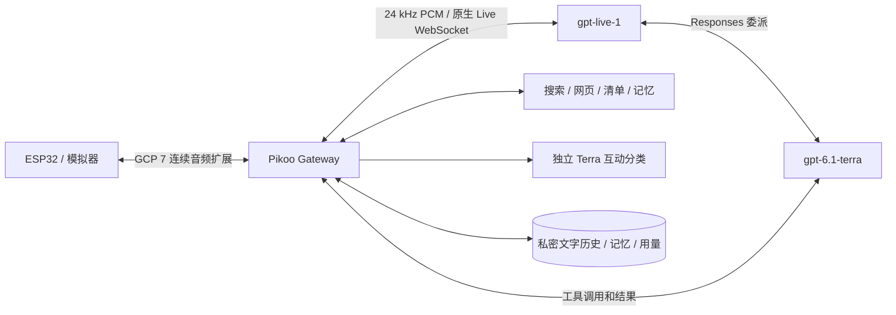

# OpenAI Live + Terra 接入

[English](openai-live.md) | **简体中文**

开发预览，更新于 2026-10-29。原生 API 与隔离工具测试已有结果，持续实机音频仍在排查，不能视为完整交付。这是真正的 Live API，不是给 Realtime 适配器改模型名称。

## 配置与部署

在 `server/` 执行 `npm ci --ignore-scripts`，使用 Node.js 24 或以上。部署全部服务器模块，不仅是 `host.mjs`；不修改上游安装包。私密配置设为 0600，通过 Node `--env-file` 或 systemd `EnvironmentFile` 在启动前加载。脱敏模板见 `server/deploy/openai-live.env.example`。

设置 `PIKOO_VOICE_PROVIDER=openai-live`、`OPENAI_API_KEY`，保留 `AGENT_PROTOCOL=none`。原有家庭 owner、设备鉴权、清单、安全网页抓取和 DeepSeek 搜索配置继续使用。两种模型固定不自动替换；Live 使用 marin，英文输入也用中文回答；Terra 使用 Standard、低推理强度、`store:false`。不自动切回其他供应商、不自动充值。

设备或模拟器必须协商 `pikoo.audio.continuous.v1`。旧客户端收到升级提示。固件只升级应用分区，保留私密配置和原厂备份；排查 Live 不改唤醒权重或音量。

## 音频与会话

网关连续将设备 16 kHz PCM16 转为 24 kHz。Live 下行是包含静音的连续音频，`audio.delta` 带 `streamId`、`generation`、`sequence`、`continuous:true`，不伪造 `audio.done`。取消、断线清空音频，丢弃旧代次。

设备用 `pikoo.playback.status` 上报队列毫秒数、DMA 估算、实际输出音量状态和本地人声活动。固件起播预缓冲 900 毫秒，最多等待 1500 毫秒；断流后重新缓冲。DMA 仍沿用有界排空估算，并非逐样本硬件回读。网络包间隔不代表回答结束。

主动停止立即清空设备，并用保存的文字重建 Live 连接。自然插话由 Live 处理，仍需结合 AEC、缓冲进行实机验收。普通休眠保留逻辑会话编号，再次唤醒注入有界的文字与摘要，不恢复旧音频流或未播完的声音。

## 空闲、记忆与工具

独立 Terra 分类新转写为明确互动、背景聊天、无法判断；每会话最多一个在途请求，最短间隔 5 秒、超时 5 秒，丢弃过期结果，无新内容不轮询。只有判定为明确互动的用户片段进入自动学习历史。分类辅助休眠与记忆，不逐包阻塞声音，也不保证完全不搭话。

有效互动及相关回答结束后 60 秒休眠；人声或不明确状态最多延长 15 秒。有效故事播放及有时限的工具任务受到保护；背景聊天不能无限续时。告别结合上下文分类，不只匹配关键词。关闭等待原生完成事件，缺失最终用量时标记估算。

工具继续受原有权限、owner 和抓取限制约束。工具调用 ID 持久去重；崩溃后未确认的操作先查询，不能自动重做。不同 ID 表达同一意图不保证恰好执行一次。迟到结果不能重新启动已关闭的音频会话。

自动记忆、摘要改用 Terra Responses，保留持久整理队列及纠错删除规则。更正/删除仍通过现有适配器使旧摘要失效；失败可见并保留待处理状态，不悄悄换回 Gemini。长会话和家庭使用需要另外验收。

## 诊断与验证

- `GET /api/pikoo/live-status` 仅允许经 SSH 的本机管理身份，展示会话、上游音频到达间隔、设备播放遥测及分类用量；不新增公网监听。
- 本地账本不等于组织余额。Live 累计秒数去重，Terra 委派、分类、摘要和记忆分别记录。当前安装按使用者要求关闭额度周期提醒，额度不足如实报错。
- 软件检查：`node --test server/*.test.mjs firmware/simulator/*.test.mjs`、`bash tools/test-core.sh`。真实 API 测试会计费，必须使用私密凭证和隔离网关。
- `live-smoke.mjs` 拒绝生产端口 3101，使用合成文本、静音与模拟播放回报，不能代替真人听感、AEC 或麦克风验收。
- `live-classification-eval.mjs` 使用 60 个版本化合成场景；分数不能当成家庭实测。
- USB `eyes freeze` / `eyes resume` 用于隔离图形负载；冻结最多持续 120 秒，不更改持久配置。

实际通过和失败项见[测试记录](openai-live-validation.md)。OpenAI 是外部付费服务，服务条款不属于项目 Apache-2.0 许可证。官方资料：[Live](https://developers.openai.com/api/docs/guides/live)、[委派](https://developers.openai.com/api/docs/guides/live-delegation)、[上下文与关闭](https://developers.openai.com/api/docs/guides/live-conversations)。
