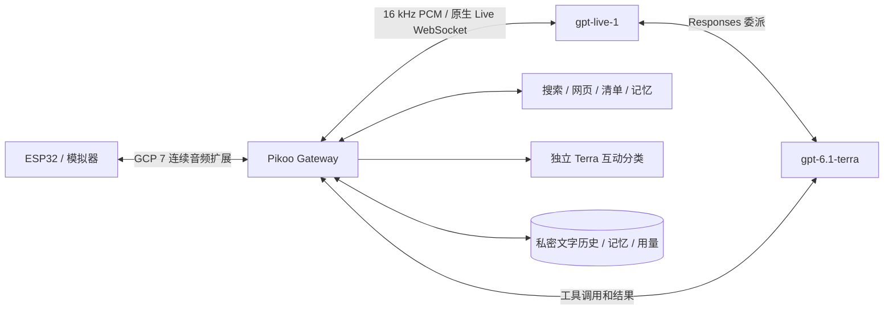

# OpenAI Live + Terra 接入

[English](openai-live.md) | **简体中文**

开发预览，更新于 2026-10-29。原生 API 与隔离工具测试已有结果，持续实机音频仍在排查，不能视为完整交付。这是真正的 Live API，不是给 Realtime 适配器改模型名称。

2026-11-01[网络后续记录](reports/live-network-2026-11-01.json)：已复现Gateway→OpenAI的TLS连接重置。当前缓解措施是台湾出口、明确IPv4及`X25519:P-256`密钥交换组，不固定服务IP、不关闭证书校验、不限制TLS版本。3次短Live启动／关闭及Terra调用成功，但家庭后续仍报告回复慢、反复显示连接中，**没有完全解决**。

仅本机可读的Live诊断新增上行计数、最大输入RMS、转写事件计数和最近互动分类。休眠日志记录原因及距有效互动的时间，不含讲话文字或PCM。一次临时的上行+12dB对照没有证明改善，已完全撤回；唤醒参数和喇叭音量不变。

独立构建`PIKOO_AUDIO_CAPTURE_BENCHMARK=ON`支持USB明确触发的4秒原音／AFE对照。不初始化网络，功放关闭；触发前不读取声音。采样时只写PSRAM，结束后导出并清空缓冲，每次启动仅接受一次采样。须使用独立构建目录、明确确认的安静合成回放窗口，不默认采集家庭对话。普通构建工具明确关闭此模式。编译不等于实机验证，录音仅留本机评估，不进入训练。

2026-11-01 的 16 kHz 优化已部署服务器，并烧入 `0.2.1-live16` 固件（仅应用分区，摘要校验通过）。板端实际协商 16 kHz、绕过播放重采样，用户反馈“声音顺畅，速度改善”。服务器 60 项、模拟器 25 项、C++ Sanitizer 检查和 ESP-IDF 编译通过。此次短测不代表长期稳定性通过；独立 API 测试仍观察到一次 1096 毫秒到达间隔。见[实际记录](reports/live-audio-16k-2026-11-01.json)。

后续音色试用选择 Coral、+12dB；此前 +4dB 被反馈为声音偏小、不够热情，+6dB 的热情已改善但音量仍不足。软件／API 验证与待完成真人听感分别记录，见[音色试用记录](reports/live-voice-style-2026-11-01.json)。如需恢复原输出设置，将服务环境改为 `PIKOO_LIVE_OUTPUT_GAIN_DB=0`、`PIKOO_LIVE_VOICE=marin`，再重启新建会话；保留已完成的 16kHz 优化。

## 配置与部署

在 `server/` 执行 `npm ci --ignore-scripts`，使用 Node.js 24 或以上。部署全部服务器模块，不仅是 `host.mjs`；不修改上游安装包。私密配置设为 0600，通过 Node `--env-file` 或 systemd `EnvironmentFile` 在启动前加载。脱敏模板见 `server/deploy/openai-live.env.example`。

设置 `PIKOO_VOICE_PROVIDER=openai-live`、`OPENAI_API_KEY`，保留 `AGENT_PROTOCOL=none`。原有家庭 owner、设备鉴权、清单、安全网页抓取和 DeepSeek 搜索配置继续使用。两种模型固定不自动替换；Live 默认 marin，通过 `PIKOO_LIVE_VOICE` 可选 marin、coral、shimmer、cedar；当前家庭试用选择 coral 并要求热情、有精神、声音清晰饱满并有语调起伏，仍保留安静倾听规则，英文输入也用中文回答；Terra 使用 Standard、低推理强度、`store:false`。不自动切回其他供应商、不自动充值。

设备或模拟器必须协商 `pikoo.audio.continuous.v1`。旧客户端收到升级提示。固件只升级应用分区，保留私密配置和原厂备份；排查 Live 不改唤醒权重或音量。

## 音色与响度

`PIKOO_LIVE_OUTPUT_GAIN_DB=12` 在服务器对下行 PCM 增加 +12dB（允许 0–12，代码默认 0）。轻声按目标增益放大，超过 0.75 满幅的峰值经过柔和压缩，向 0.94 满幅上限靠近；不增加音频缓冲、不改变采音与唤醒链路，板端仍保留 0dB DAC 设置。峰值保护不代表实物喇叭绝不会失真。

`PIKOO_LIVE_VOICE=coral` 在会话启动时选择内置音色，修改后需要新建 Live 会话，近期文字上下文仍由 Gateway 管理。提示词要求热情有活力、清晰饱满、有语调起伏，避免气声、耳语和拖虚的句尾，同时保留背景聊天时安静、插话时让出话轮的规则。音色适合与否要真人试听，API 接受不能代替听感。依据：[官方音色配置](https://developers.openai.com/api/docs/guides/live-conversations)、[语气提示](https://developers.openai.com/api/docs/guides/live-prompting)。

## 音频与会话

2026-11-01 起，Live 输入、输出统一使用 16 kHz 单声道 PCM16（`audio.format`），上行不再重采样。声明 `pikoo.audio.pcm16.v1` 的新版设备与模拟器接收原生 16 kHz；新版固件按硬件采样率直接播放。未升级的连续音频客户端仍收到网关有状态转换后的 24 kHz 兼容音频，不会突然无声或变调。`voice.ready.outputSampleRate` 与每包 `audio.delta.sampleRate` 标明实际格式。两种采样率均保持 900 毫秒起播预缓冲、1500 毫秒兜底等待和 30 秒队列上限。相较原 24 kHz，服务器到 OpenAI 的双向音频载荷各减少约三分之一；设备下行需升级后才享有同样缩减，JSON/Base64 和传输开销另计。此优化不能单独解决 TLS 断开、收音识别或代理抖动。格式依据见 [OpenAI 官方 WebSocket 文档](https://developers.openai.com/api/docs/guides/voice-websockets)。Live 下行仍是包含静音的连续音频，`audio.delta` 带 `streamId`、`generation`、`sequence`、`continuous:true`，不伪造 `audio.done`。取消、断线清空音频，丢弃旧代次。

设备用 `pikoo.playback.status` 上报队列毫秒数、DMA 估算、实际输出音量状态和本地人声活动。固件起播预缓冲 900 毫秒，最多等待 1500 毫秒；断流后重新缓冲。DMA 仍沿用有界排空估算，并非逐样本硬件回读。网络包间隔不代表回答结束。

主动停止立即清空设备，并用保存的文字重建 Live 连接。自然插话由 Live 处理，仍需结合 AEC、缓冲进行实机验收。普通休眠保留逻辑会话编号，再次唤醒注入有界的文字与摘要，不恢复旧音频流或未播完的声音。

## 空闲、记忆与工具

独立 Terra 分类新转写为明确互动、背景聊天、无法判断；每会话最多一个在途请求，最短间隔 5 秒、超时 5 秒，丢弃过期结果，无新内容不轮询。只有判定为明确互动的用户片段进入自动学习历史。分类辅助休眠与记忆，不逐包阻塞声音，也不保证完全不搭话。

有效互动及相关回答结束后 60 秒休眠；人声或不明确状态最多延长 15 秒。有效故事播放及有时限的工具任务受到保护；背景聊天不能无限续时。告别结合上下文分类，不只匹配关键词。关闭等待原生完成事件，缺失最终用量时标记估算。

工具继续受原有权限、owner 和抓取限制约束。工具调用 ID 持久去重；崩溃后未确认的操作先查询，不能自动重做。不同 ID 表达同一意图不保证恰好执行一次。迟到结果不能重新启动已关闭的音频会话。

自动记忆、摘要改用 Terra Responses，保留持久整理队列及纠错删除规则。更正/删除仍通过现有适配器使旧摘要失效；失败可见并保留待处理状态，不悄悄换回 Gemini。长会话和家庭使用需要另外验收。

## 诊断与验证

- `GET /api/pikoo/live-status` 仅允许经 SSH 的本机管理身份，展示会话、上游音频到达间隔、设备播放遥测及分类用量；不新增公网监听。
- 本地账本不等于组织余额。Live 累计秒数去重，Terra 委派、分类、摘要和记忆分别记录。当前安装按使用者要求关闭额度周期提醒，额度不足如实报错。
- 软件检查：`node --test server/*.test.mjs firmware/simulator/*.test.mjs`、`bash tools/test-core.sh`。真实 API 测试会计费，必须使用私密凭证和隔离网关。
- `live-smoke.mjs` 拒绝生产端口 3101，使用合成文本、静音与模拟播放回报，不能代替真人听感、AEC 或麦克风验收。
- `live-classification-eval.mjs` 使用 60 个版本化合成场景；分数不能当成家庭实测。
- USB `eyes freeze` / `eyes resume` 用于隔离图形负载；冻结最多持续 120 秒，不更改持久配置。

实际通过和失败项见[测试记录](openai-live-validation.md)。OpenAI 是外部付费服务，服务条款不属于项目 Apache-2.0 许可证。官方资料：[Live](https://developers.openai.com/api/docs/guides/live)、[委派](https://developers.openai.com/api/docs/guides/live-delegation)、[上下文与关闭](https://developers.openai.com/api/docs/guides/live-conversations)。
